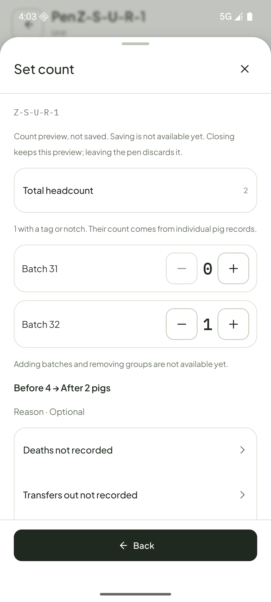
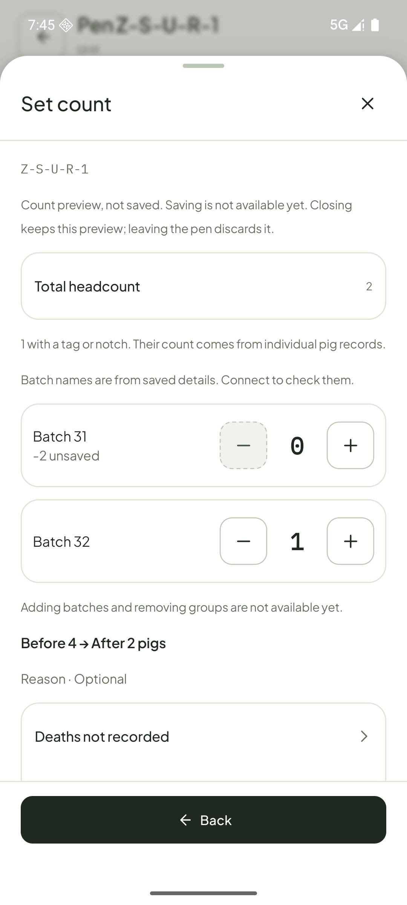
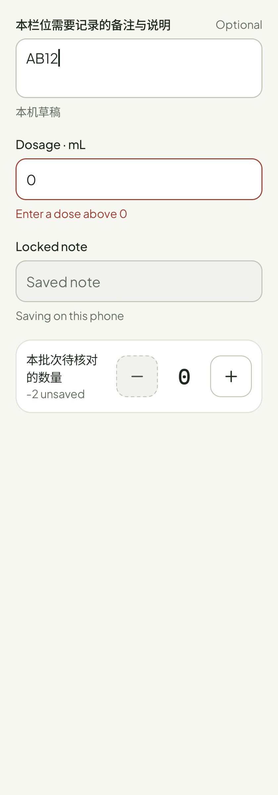

# Android 输入控件收尾

2026-10-26。参照 Sentri-UI `main@f66affd` 的 Field／Stepper README、状态样例和 tokens。两者在设计源中仍是 candidate；本次只在 Android 做可审核实现，未修改 Sentri-UI 组件、未提升成熟度。

## 调整与应用位置

| 控件 | 原问题 | Android 调整 | 应用位置 |
| --- | --- | --- | --- |
| `SentriStepper` | 盘点用通用图标按钮拼装，下限只淡化图标；没有逐组未保存提示 | Count／Row 两个当前所需形态；下限与上限为灰底虚线边框、清晰图标。拒绝的点击说明边界，数字保持墨色，变化显示有符号的“尚未保存”。无障碍提供加减动作；组件不提交业务数据 | 栏位 → 设置头数：单组总数、多组批次数量 |
| `SentriField` | 标准 Material 浮动标签与设计不一致，提示、计数和禁用说明散在外面 | 固定可换行标签、12dp 圆角、至少 48dp 控件；原生文本编辑和键盘。错误优先于提示，禁用有说明；支持选填、单位和多行文本 | 治疗共享／逐猪剂量、备注、药品与病症搜索；栏位备注、报障名称／描述、盘点 Other 说明、只读病症目录搜索 |

剂量仍由原模型控制共享／单猪覆盖；备注仍由原表单限制 200 字。本次没有开放治疗、盘点或报障正式保存。专用“查找猪只”的搜索／清空／扫码组合保持既有复合搜索控件，不把它改成普通表单 Field。

Stepper 的范围由调用方业务模型决定，组件再次拒绝越界；下限键仍可被触摸以说明原因，但没有数量变化，语义标为不可用。Row 的状态留在标签区，主数量的状态在数字下方；没有在本机草稿上显示绿色成功。当前只实现被真实页面消费的 Count／Row，不声称 Well 等未用形态已交付。

## 查看效果

以下均为模拟器 fixture，用于组件审核，不是真实猪只或治疗记录。

旧的盘点拼装按钮：

新的边界与未保存状态：

Field 的长中文标签、选填、错误和禁用说明：

已目测：新的下限按钮仍清晰可认，虚线与底色区分可操作键；盘点每组保留独立数量和草稿变化。Field 固定标签和说明位置一致，中文不截断。此判断不替代用户批准；组件回写仍等待审核。

## 验证范围

API 36 模拟器的 5 项关键检查通过：Stepper 下限／上限拒绝、禁用不改变数值；Field 文本／长标签／错误／禁用；盘点单多组／过期数据／返回保留／资料失败；备注本机草稿入口；治疗共享／逐猪剂量和长目录。最后版本又复核两项组件用例并留图。

没有重复执行全类 UI 回归；真机、大字体、TalkBack 实际朗读、所有输入法、七组以上盘点的专页布局及未消费变体仍未验证／未实现，后续按具体页面推进。`scripts/verify.sh` 最终通过：278 JVM、1197 双语资源／315 映射、101 operations／823 字段，Lint 无错误但有既有警告。
