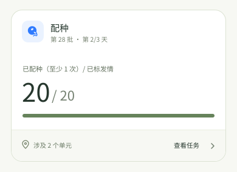
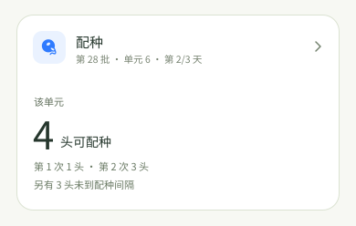

# 配种首页卡片：按旧版实际数据重画

> 产品评审稿。图片中的批次、时间和头数是排版示例，不是农场数据或 Android 已实现页面。样式参照 Sentri-UI 首页任务卡；业务数字先对照旧版首页与配种任务页。Sentri-UI `breeding` 仍为 earlier/draft，未把它的提案当作已确认规则。

## 总览：已配种 / 已发情

旧版总览卡显示“已配种 / 发情母猪”和任务进行日数。新卡仍显示这个指标，只把“已配种”写明为**至少有 1 次配种记录的母猪**。这里的 8/20 不是“已完成全部配种次数”，也不是“今天待配种 12 头”。查情还在继续时，已发情母猪数可能变化。

| 卡面 | 旧版字段及新版口径 |
| --- | --- |
| 第 28 批、第 2/3 天 | 批次与 `calculateDoingDays(task)`；只有计划起点、时长可靠时显示日序。 |
| 已配种 8 | 旧版 `mating_pig.last_mating_at` 有值的母猪数。新版先用**同一范围内、非禁用且已标发情**的任务猪只过滤，避免旧首页分子包含禁用猪而分母排除禁用猪。按稳定猪只 ID 计，不按配种记录条数计。 |
| 已标发情 20 | 旧版 `mating_pig.estrus_at` 有值且未禁用的任务猪只数；任务页也使用这一口径。 |
| 横条 | 8/20 的“至少配过一次”覆盖比例。它不表示每头母猪的配置次数都已完成，也不驱动任务结束。 |
| 涉及 2 个单元 | 当前分区内有此任务猪只的单元数；点击整卡进任务概况。 |

### 已发情母猪均有配种记录

20/20 只说明这些母猪**各有至少一次**配种记录。有些母猪可能还需要第 2 次或第 3 次，查情任务也可能继续加入新对象。因此任务状态仍取权威状态；首页不因横条满格显示“结束任务”。旧版满格后有快捷入口，但它按四舍五入后的百分比判断，且结束配种会影响未配种母猪的批次归属。当前 Sentri-UI 配种草稿把批次配种阶段的结束放在主管／批次流程中，手机端没有确认过可执行入口。本稿先不在首页设计这个按钮；若产品决定保留手机结束流程，需要单独确定权限、查情结束前置条件与受影响母猪名单。

### 尚无已标发情母猪

任务仍在进行，但分母为 0 时不画 `0/0`、`0%` 或空横条。“暂无已标发情母猪”只描述当前记录，不推断查情任务未完成、正在等待某个时间或无人需要处理。任务若根本没有有效猪只，沿用旧首页的不出卡规则。

## 单元：旧版的配种次数与间隔

旧版单元卡不使用总览的 8/20 横条。它按任务配置的配种次数，查看每头母猪已有几次记录，分别统计“可配种／未到期”。这与总览的一次覆盖率是两种数据，不能叠加成一个百分比。新版单元卡把这些数压成一眼能读的主数和短说明；整卡进入该单元配种名单，具体母猪、精液批次和记录仍在任务页。

### 第一次与后续配种同时可做

“4 头可配种”是当前单元、已标发情、未禁用、尚未达到配置次数且下一次配种时间已到的**去重母猪数**。第 1 次 1 头、第 2 次 3 头是这 4 头的拆分；另有 3 头未到间隔，不能与主数相加后称为“待配种 7 头”。只出现一种次数时，短说明只显示那一种；配种次数超过两种时，详情列全，不在首页挤满多行。

### 当前都在等间隔

当没有可配种母猪，且确有未到间隔的母猪时，显示人数与**最近**一个可配时间。旧首页 `distanceToNext` 在“所有距离均为正”时取最大值，会把最晚时间当成下次时间；新卡取有效待配对象的最早时间。若时间依据不可靠，只写“3 头未到间隔”，不补一个时刻。

### 本单元已达配置次数

当前单元的已标发情母猪都达到配置次数时，显示该单元的事实，不把整项任务说成已完成。旧版单元计算的最后一档将“达到次数”与“可配下一次”混在同一档；新卡先排除已达次数的母猪，再计算当前可配数。额外配种仍由任务详情中的明确入口处理。

### 本单元暂无已标发情母猪

本单元有任务猪只但没有已标发情记录时，只展示入口；不把缺少发情时间当作“第 1 次现在可配”。无有效任务猪只则不出卡。

## 上线前需核对的一处业务差异

旧首页 `useMatingUnitData` 以“发情时间 + 首次间隔”算第 1 次可配，但它在后备母猪与经产母猪的两个 KPI 配置中取第一个非零值，没有按每头母猪区分。旧配种任务名单 `pzPigpenBuilder` 又把无配种记录的母猪直接显示为可配。Sentri-UI 配种研究也把首次等待规则列为未决。这会实质改变单元卡“可配种”人数。**卡片结构和总览口径可以先确认；真实首页接入前需以产品与后端的统一规则确定第 1 次可配时间。**未确认时不显示猜测的“可配 N 头”，仍可进入配种名单核对。

参考：[旧首页配种计算](../../Sentri/mobile_webapp/src/pages/home/components/hooks/useTaskData.ts)、[旧首页配种封装和快捷结束](../../Sentri/mobile_webapp/src/pages/home/components/tasks/MatingTask.tsx)、[旧总览卡](../../Sentri/mobile_webapp/src/pages/task/pz/components/TaskProgress.tsx)、[旧单元卡](../../Sentri/mobile_webapp/src/pages/task/pz/components/UnitDetailTaskProgress.tsx)、[旧配种任务页口径](../../Sentri/mobile_webapp/src/pages/task/pz/assists.tsx)、[旧名单首次配种状态](../../Sentri/mobile_webapp/src/pages/task/pz/pzPigpenBuilder.tsx)、[新版配种 PRD](../../Sentri-UI/features/breeding/PRD.md)、[新版配种研究](../../Sentri-UI/ux/research/tasks/breeding.html)、[首页卡片样式规则](../../Sentri-UI/ux/research/home/HOME-TASK-CARD-COMPONENT.md)。
