# 首页任务卡多场景展示方案

> 2026-10-14 · 早期多场景探索，部分图已被后续产品决定替代。当前卡片统一看[生产任务首页卡片总览](home-production-task-cards.md)。示例数字不是农场数据，也不是 Android 已实现页面。查情、配种、返情分别见[查情](home-heat-card-revision.md)、[配种](home-breeding-card-revision.md)、[返情暂选卡](home-return-heat-card-revision.md)。

**示例时钟：** 图片统一假设今天是 10 月 12 日；“今天”“明天”和图中的固定日期都按这一虚构时点理解，不表示当前真实任务日期。

推导依据：[旧版首页任务计算](../../Sentri/mobile_webapp/src/pages/home/components/hooks/useTaskData.ts)、[返情与孕检计算](../../Sentri/mobile_webapp/src/pages/home/components/hooks/useReproductiveTaskData.ts)、[旧版任务卡分发](../../Sentri/mobile_webapp/src/pages/home/components/TaskRenderer.tsx)及 [Sentri-UI 任务卡规则](../../Sentri-UI/ux/research/home/HOME-TASK-DISPLAY-RULES.md)。旧代码中的计算是证据，不直接作为新版医疗、截止或状态规则。

## 先决定卡片在哪里，再决定显示什么

1. **权威任务状态先归栏。** 已完成／已提前结束进已关闭收据；尚未开始且未来七天进入执行期进紧凑预告；已开始、今日／此前计划开始但未启动、已指派且可执行的无时间任务进主列表。记录完成率绝不产生另一种任务状态。
2. **主列表卡再选一条主信息。** 可信且有处理去向的现场异常 → 明确截止已过的对象 → 当前有窗口的对象 → 下一个已知动作 → 等待上游事实 → 数据不足的安全说明。分娩的真实进行记录优先于日期预测。相同对象不能在主数和辅助数相加。
3. **辅信息只放一条。** 优先写明确逾期子集，其次写影响本次执行的轮次／复查／路线，最后写下一次时间。更多详情留在任务页。进度条仅在分母可信时显示，并写清统计内容。
4. **范围与离线只改投影。** 总览和单元沿用同一任务 ID；单元只缩小对象与方向。离线待上传提示独立于服务端进度，不能使卡片变成完成。未知、加载失败、无权限与真实 0 分开处理。

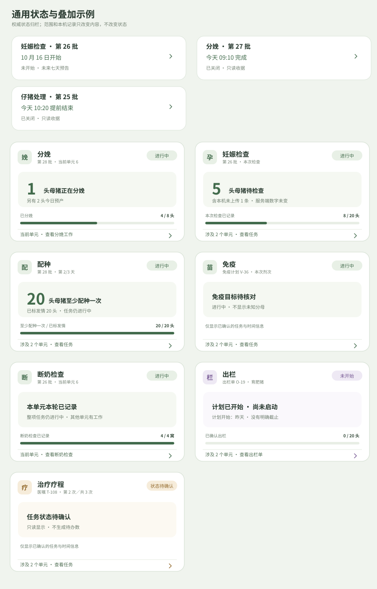

这张通用图展示未开始预告、完成／提前结束收据、单元范围、本机待上传、记录 100% 但任务仍进行中、单元本轮已做完、计划开始日已过却未启动、状态未知，以及关键数据缺失。查情、配种、返情检查分别采用单独分支；转舍的转出／转入另外示范单元范围投影。

## 逐类分支

### 查情（早期索引）

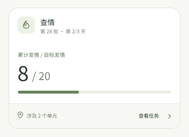

沿用旧版总览的累计发情／目标发情与任务天数；目标达到、目标缺失、单元有迹象见[查情分支图和字段说明](home-heat-card-revision.md)。旧仓库中保留的轮次文案不进入首页卡。

### 配种（总览与单元分支）

总览沿用旧版已配种／已发情母猪；单元按已有配种次数和间隔区分可配、等待与已达次数。图片及旧版计算差异见[配种卡片修订](home-breeding-card-revision.md)。

### 返情检查（总览与单元分支）

本轮暂沿旧版结果与预计日期口径；后端日统计快照未修复时不画饼点。具体分支见[返情暂选卡](home-return-heat-card-revision.md)。[新版候选](home-return-heat-feature-alignment.md)待 feature 定稿后再决定。

### 妊娠检查（5 种场景）

旧版把未孕与未记录混入待检，并把不确定结果作单独复查线索；新版以本次提交和明确复查计划判定。

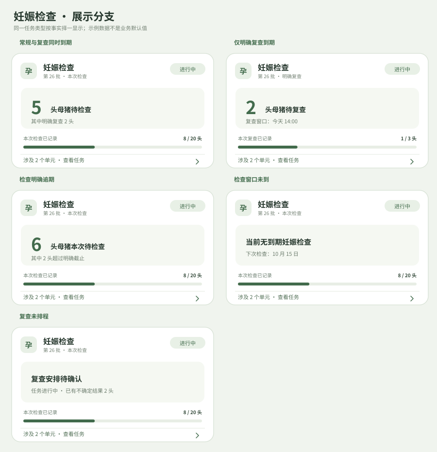

| 分支与独立图片 | 触发条件 | 卡片取舍 |
| --- | --- | --- |
| [常规与复查同时到期](home-card-variants/pregnancy/due.svg) | 本次窗口已开，常规和复查均有对象，且没有明确逾期对象。 | 复查包含在主数内，不重复计猪。 |
| [仅明确复查到期](home-card-variants/pregnancy/recheck.svg) | 常规检查本轮无待办，仅有已排程复查。 | 标题和进度限定为本次复查。 |
| [检查明确逾期](home-card-variants/pregnancy/overdue.svg) | 本次检查配置明确截止，截止已过。 | 主数包括逾期对象，辅助只报子集。 |
| [检查窗口未到](home-card-variants/pregnancy/next.svg) | 权威状态仍进行中，本次无人到期，已知下一日期。 | 进度保留，本卡不移动到未来预告。 |
| [复查未排程](home-card-variants/pregnancy/unknown.svg) | 出现不确定结果，但无权威复查时间。 | 不自动生成今天待复查。 |

### 分娩（5 种场景）

旧版同时计算预产、超预产、正在分娩；新版真实分娩记录优先，预产日已过只是核对提示，不等同任务逾期。

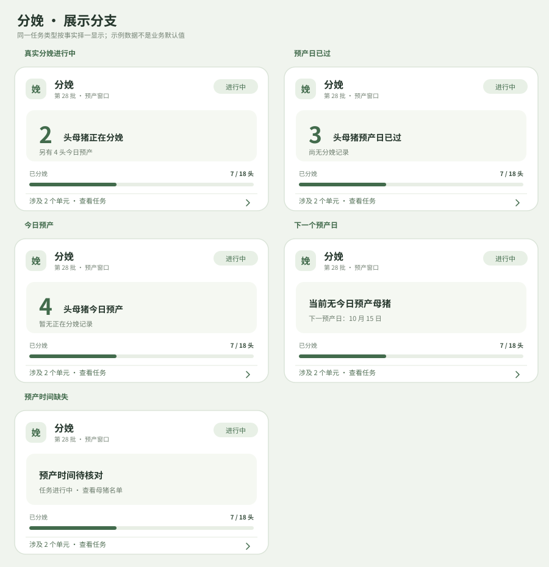

| 分支与独立图片 | 触发条件 | 卡片取舍 |
| --- | --- | --- |
| [真实分娩进行中](home-card-variants/farrowing/live.svg) | 已有母猪的分娩开始记录。 | 真实进行记录优先于预产日预测。 |
| [预产日已过](home-card-variants/farrowing/past-expected.svg) | 没有真实进行记录；部分母猪预产日已过且尚未分娩。 | 提示核对母猪与记录，不标成任务逾期。 |
| [今日预产](home-card-variants/farrowing/due-today.svg) | 没有真实进行记录或过预产日对象。 | 只说预产，不断言已经开始分娩。 |
| [下一个预产日](home-card-variants/farrowing/next.svg) | 当前没有真实进行或今日预产对象。 | 显示最近预产日，任务仍进行中。 |
| [预产时间缺失](home-card-variants/farrowing/missing-date.svg) | 任务在进行，但缺可靠交配／预产日。 | 不填默认 114 天来制造到期数。 |

### 产后检查（5 种场景）

旧版单元过滤与时间差计算需要复核；新版仅由实际分娩时间和任务配置窗口计算。

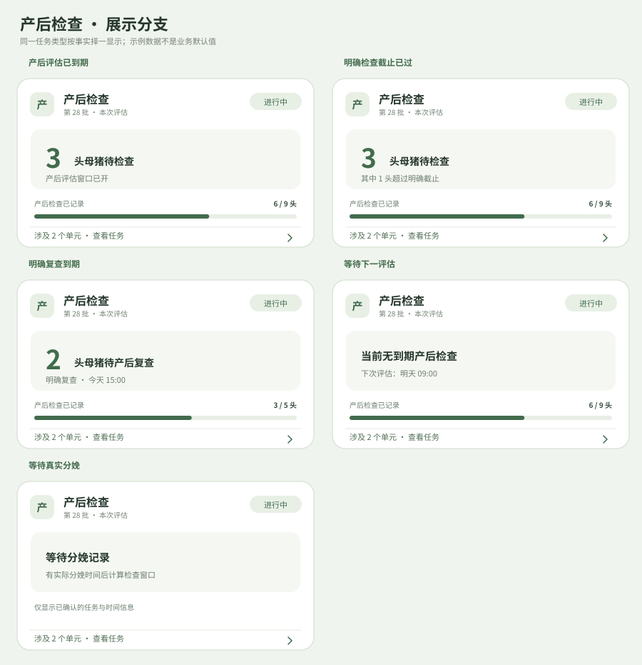

| 分支与独立图片 | 触发条件 | 卡片取舍 |
| --- | --- | --- |
| [产后评估已到期](home-card-variants/postpartum/due.svg) | 实际分娩时间存在，本次检查窗口已打开，且没有明确逾期或复查对象。 | 显示当前待检查数和窗口。 |
| [明确检查截止已过](home-card-variants/postpartum/overdue.svg) | 本次检查有明确截止，截止已过且仍有未记录对象。 | 待检查数包含逾期对象，辅助只报逾期子集。 |
| [明确复查到期](home-card-variants/postpartum/recheck.svg) | 复查是独立排程且已到窗口，没有明确逾期对象。 | 异常答案本身不自动产生复查。 |
| [等待下一评估](home-card-variants/postpartum/next.svg) | 已分娩对象的检查窗口尚未到。 | 保留进度，展示最近计划时间。 |
| [等待真实分娩](home-card-variants/postpartum/farrowing.svg) | 本任务进行中，但当前没有可用实际分娩时间。 | 不提前把未分娩对象放入分母。 |

### 仔猪处理（5 种场景）

旧版按护理项目逐项统计，并有缺日期时从当前时间推计划的回退；新版按窝去重，缺计划不补今天。

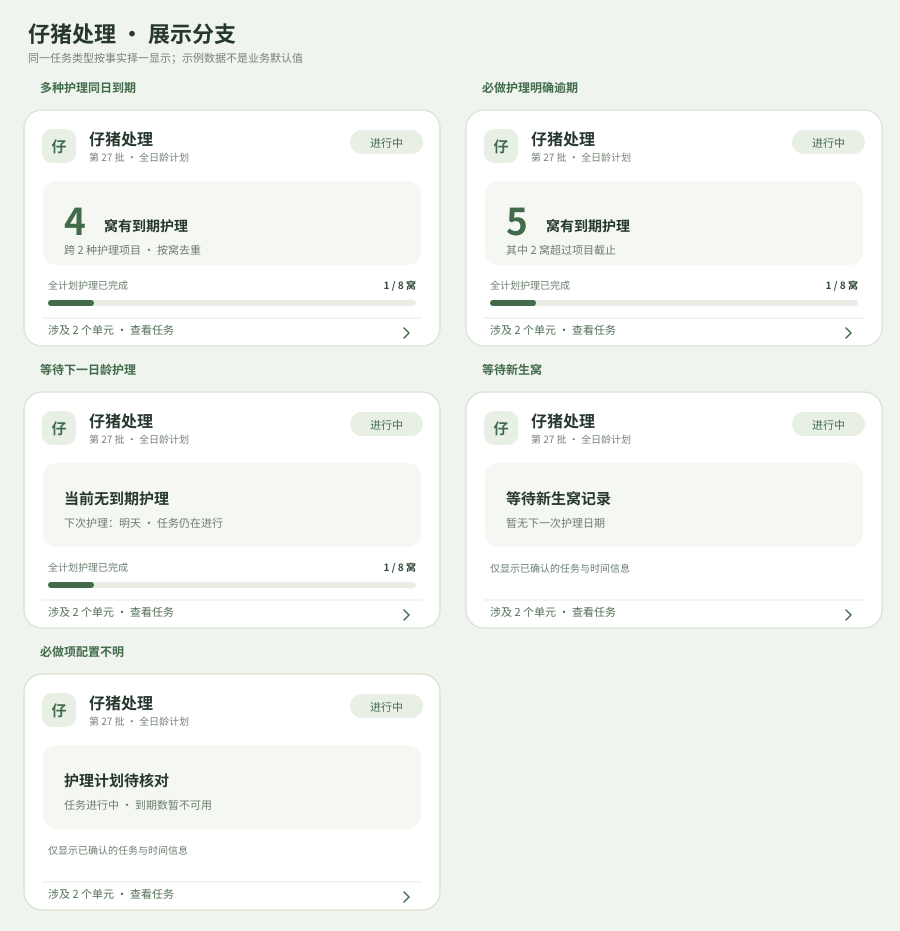

| 分支与独立图片 | 触发条件 | 卡片取舍 |
| --- | --- | --- |
| [多种护理同日到期](home-card-variants/piglet/due.svg) | 至少一项必做护理已到期且未记录，没有明确逾期项目。 | 同窝多个护理项仍只计一窝。 |
| [必做护理明确逾期](home-card-variants/piglet/overdue.svg) | 已配置项目截止，仍有未做的必做项。 | 过期窝包含于主数。 |
| [等待下一日龄护理](home-card-variants/piglet/next.svg) | 今天没有到期护理，后续计划已知。 | 任务继续留在主列表。 |
| [等待新生窝](home-card-variants/piglet/litters.svg) | 没有可纳入计划的分娩／窝记录。 | 不把未来护理虚构成今天待办。 |
| [必做项配置不明](home-card-variants/piglet/plan-unknown.svg) | 护理项目或可选项到期规则缺失。 | 不自动跳过、完成或推导百分比。 |

### 断奶检查（4 种场景）

旧 LACTATION 页面标题就是断奶检查；新版改按窝／栏，需先建立新旧记录对象映射。

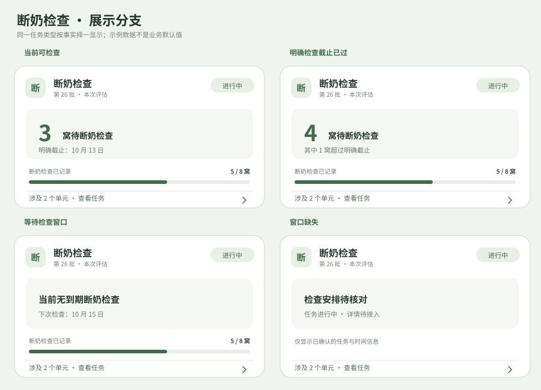

| 分支与独立图片 | 触发条件 | 卡片取舍 |
| --- | --- | --- |
| [当前可检查](home-card-variants/weaning/due.svg) | 有明确检查窗口，窝／栏已进入窗口，且没有明确逾期对象。 | 检查和实体转舍分开。 |
| [明确检查截止已过](home-card-variants/weaning/overdue.svg) | 检查计划有截止且有未记录对象。 | 主数含逾期对象，辅助提示子集。 |
| [等待检查窗口](home-card-variants/weaning/next.svg) | 本任务进行中，但本单元／范围尚未到检查日。 | 显示下一检查日。 |
| [窗口缺失](home-card-variants/weaning/unknown.svg) | 有任务但缺稳定对象名单或检查计划。 | 显示状态，不补待检窝数和比例。 |

### 治疗疗程（5 种场景）

旧卡强调药品、剂量、频次及整疗程比例；新版首页只聚焦本次给药窗口，剂量留医嘱详情。

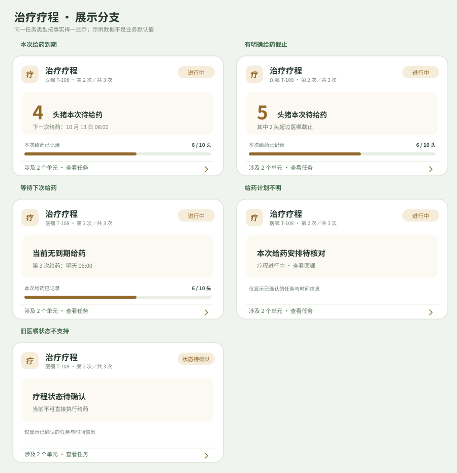

| 分支与独立图片 | 触发条件 | 卡片取舍 |
| --- | --- | --- |
| [本次给药到期](home-card-variants/treatment/due.svg) | 当前轮次计划时间已到，有未记录对象，且没有明确逾期对象。 | 显示轮次和去重猪只。 |
| [有明确给药截止](home-card-variants/treatment/overdue.svg) | 医嘱明示本次截止且有未给药记录。 | 只报告事实，不推荐补剂量。 |
| [等待下次给药](home-card-variants/treatment/next.svg) | 当前轮次已记录或尚未到下一次时间。 | 疗程仍进行中，不因本轮满条关闭。 |
| [给药计划不明](home-card-variants/treatment/unknown-plan.svg) | 医嘱缺本次排程或目标名单。 | 隐藏待给药数与比例，打开医嘱核对。 |
| [旧医嘱状态不支持](home-card-variants/treatment/legacy-status.svg) | 旧数据返回未纳入本版产品的中断状态。 | 只读提示，不把它当暂停／继续按钮。 |

### 免疫（4 种场景）

旧卡用“下发 N 天”；新版使用排程与明确截止，创建时间不能代替执行时间。

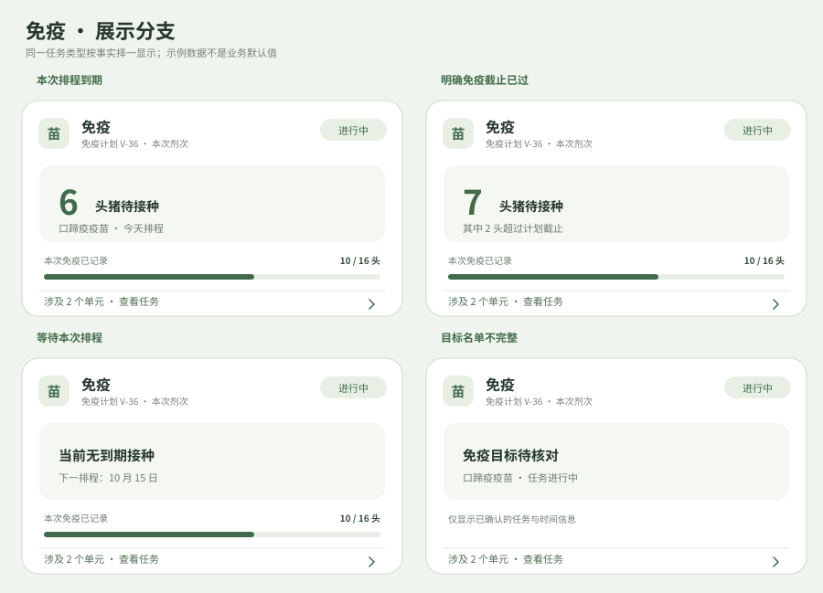

| 分支与独立图片 | 触发条件 | 卡片取舍 |
| --- | --- | --- |
| [本次排程到期](home-card-variants/vaccination/due.svg) | 已指派本次免疫，排程时间已到，且没有明确逾期对象。 | 主数为本剂次未接种的去重猪只。 |
| [明确免疫截止已过](home-card-variants/vaccination/overdue.svg) | 计划有明确截止，仍有本剂次未接种对象。 | 不用“下发 N 天”判断逾期。 |
| [等待本次排程](home-card-variants/vaccination/next.svg) | 免疫任务进行中，当前范围暂无到期猪只。 | 显示下一剂次／时间，不生成执行按钮。 |
| [目标名单不完整](home-card-variants/vaccination/unknown-target.svg) | 疫苗可识别，但目标数或排程未验证。 | 不显示伪造分母、百分比。 |

### 转舍（6 种场景）

旧首页按单元拆成转出／转入卡；新版一单一张，单元仅改变方向和计数。

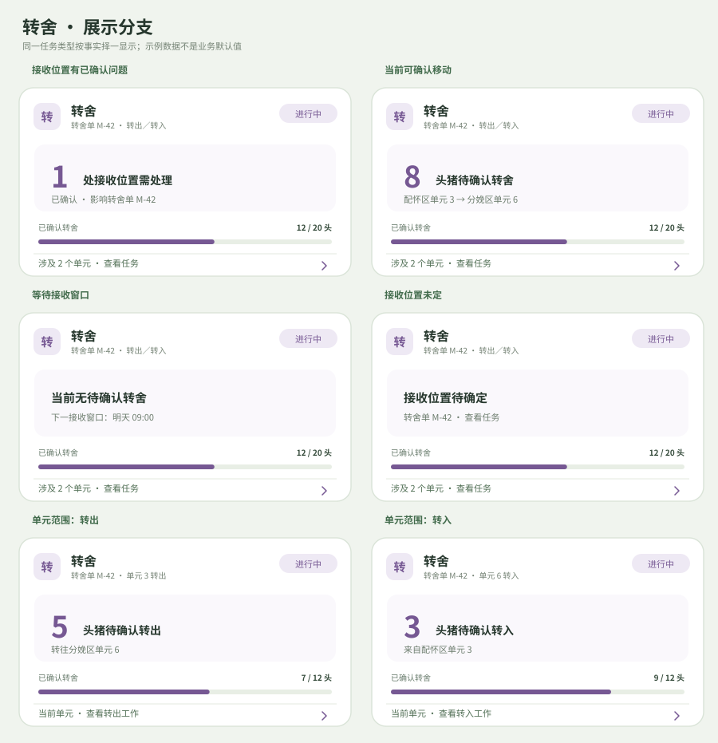

| 分支与独立图片 | 触发条件 | 卡片取舍 |
| --- | --- | --- |
| [接收位置有已确认问题](home-card-variants/transfer/confirmed-issue.svg) | 有可处理的接收位置异常，已与本转舍单绑定。 | 先显示问题，再在详情看移动名单；不得臆断栏位容量。 |
| [当前可确认移动](home-card-variants/transfer/due.svg) | 转舍计划窗口已开、有未确认移动，且没有已确认的接收位置问题。 | 总览同单只一张。 |
| [等待接收窗口](home-card-variants/transfer/next.svg) | 本单进行中，但当前没有可确认移动对象。 | 显示下一个明确窗口。 |
| [接收位置未定](home-card-variants/transfer/destination.svg) | 已有转舍单与对象，但目标单元尚未指定。 | 提示补位置，不推断可执行移动。 |
| [单元范围：转出](home-card-variants/transfer/unit-out.svg) | 当前单元是来源单元。 | 只缩小范围与方向，任务 ID 不变。 |
| [单元范围：转入](home-card-variants/transfer/unit-in.svg) | 当前单元是接收单元。 | 与转出同属一单，按方向显示接收数。 |

### 出栏（3 种场景）

旧卡以出栏比例和范围为主；新版优先给出本单当前待确认数，缺时间时明确标未设截止。

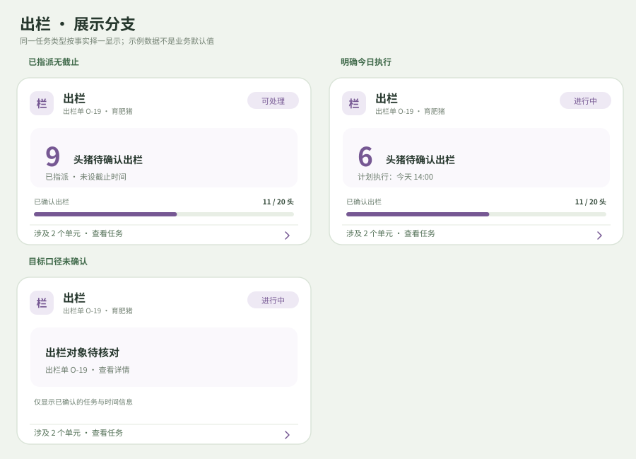

| 分支与独立图片 | 触发条件 | 卡片取舍 |
| --- | --- | --- |
| [已指派无截止](home-card-variants/outbound/undated.svg) | 出栏单已指派、当前可执行，但没有计划时间。 | 明确写未设截止，不根据创建时间判逾期。 |
| [明确今日执行](home-card-variants/outbound/scheduled.svg) | 出栏单有可靠执行窗口且已到。 | 当前待确认数优先于累计比例。 |
| [目标口径未确认](home-card-variants/outbound/unknown-target.svg) | 单据存在，但选定对象或分母无法可靠读取。 | 只显示任务身份和状态。 |

### 采样（4 种场景）

旧首页合并最近七天创建的采样任务；新版一任务实例一卡，按真实目标类型和地点决定范围。

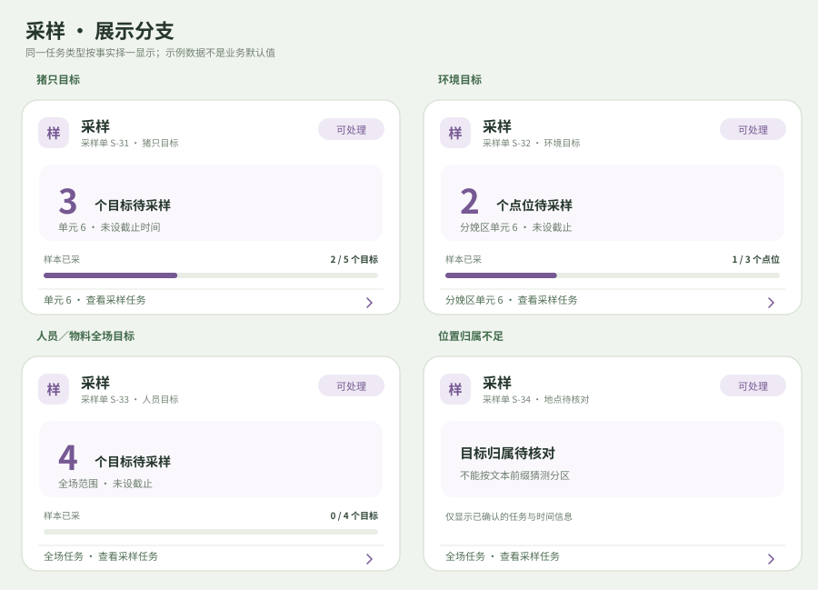

| 分支与独立图片 | 触发条件 | 卡片取舍 |
| --- | --- | --- |
| [猪只目标](home-card-variants/sampling/pig.svg) | 本采样单有明确猪只目标及单元。 | 按目标 ID 去重；一单一张卡。 |
| [环境目标](home-card-variants/sampling/environment.svg) | 本采样单目标是有可靠分区／单元归属的环境点。 | 目标单位是采样点，不写成猪只。 |
| [人员／物料全场目标](home-card-variants/sampling/farm-wide.svg) | 目标无明确分区归属，但属于已安排任务。 | 只在全场任务入口出现一次。 |
| [位置归属不足](home-card-variants/sampling/unknown-scope.svg) | 目标地点字符串不足以验证分区。 | 不复制到每个分区；从全场入口核对。 |

## 不出卡与边界

- 草稿、未指派且不可执行的无时间工作、无任务实例的普通工具入口，不生成首页任务卡。旧版采精按公猪存栏生成入口，当前只在适用单元工具箱显示[采精入口示例](home-card-examples/semen-entry.svg)。
- 权威状态无法识别时只读显示“状态待确认”；涉及对象名单缺失、时间无效或分页不完整时，不展示推算的待办数、百分比或“逾期”。
- 显示真实 0 时需有完整名单和有效窗口证据；否则使用“待核对”。单元本轮已记录只说明该单元，不改变全任务状态。
- 治疗疗程、免疫计划和转舍单的完整生命周期在 Sentri-UI 仍是提案；有赖后端确认的分支以条件表述，不把示例认作已上线能力。

图片由[生成脚本](../scripts/generate_home_card_variants.py)和[基础卡片生成器](../scripts/generate_home_card_examples.py)生成。修改分支后先运行两个脚本，再逐张检查图片与本表是否一致。
