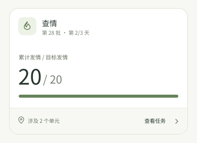
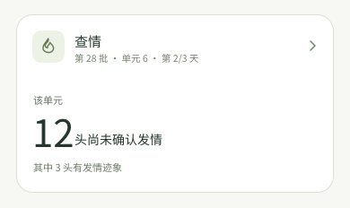

# 查情首页卡片：旧逻辑、新样式

> 设计样稿，等待产品确认。数字是虚构示例，不是当前农场数据。

这张卡只保留旧版首页总览卡实际展示的业务信息：任务名、批次、进行天数，以及“累计发情 / 目标发情”结果。新版只调整卡片的字体、间距、图标、进度条和总览页脚。点击整卡进入查情任务。

| 位置 | 数据来源与口径 |
| --- | --- |
| 第 2/3 天 | 旧版 `ProductionTaskList` 的 `calculateDoingDays(task)`；仅在有可靠计划起点和时长时展示。 |
| 累计发情 8 | 旧版 `useEstrusSummaryData` 对非禁用任务猪只中 `estrus_pig.is_in_estrus` 为真的数量。 |
| 目标发情 20 | 旧版同一 hook 的 `min(max_breeding_sows_per_batch, 非禁用任务猪只数)`。这是旧版目标口径，不是已检查总数。 |
| 绿色横条 | 8/20 的发情结果比例；**不代表查情完成率，也不决定任务状态**。 |
| 涉及 2 个单元 | 首页总览的真实任务覆盖范围，示例值只用于排版。 |

本卡不加入“本轮／下轮”“本轮待查”“逾期”或“计划查情时间已到”。旧仓库保留若干轮次文案，但当前首页卡片没有使用轮次计算。

## 必要的展示分支

| 场景 | 展示规则 | 依据 |
| --- | --- | --- |
| 总览：目标尚未达到 | 用上面的 8/20 基准卡。 | 旧版首页总览的 `cqLength / allLength`。 |
| 总览：目标达到或超过 | 以原始数量 `cqLength >= allLength > 0` 判断；数字显示真实值，横条最多填满，仍由任务状态决定是否关闭。 | 旧版用四舍五入后的百分比显示快捷结束入口；新版首页不以结果比例改变任务状态。 |
| 总览：目标数缺失或为 0 | 保留已发情数，改写“目标发情数待核对”，隐藏比例条。 | 旧计算可能得到 0 分母；8/0 和 0% 都会误导。 |
| 单元：有发情迹象 | 展示旧版 `needLength` 与 `withSign` 两个数字；迹象数是前者的子集。 | 旧版单元卡只有 `withSign > 0` 时才出现统计区；`expectEstrusLength` 当前固定为 0。 |

### 总览：目标达到

达到 20/20 只改变结果数字和横条。若结果超过目标，例如 22/20，数字显示 22/20，横条保持满格，不倒扣、不截断真实数量，也不在首页生成结束按钮。

**快捷结束入口评估：不放入新版首页卡。** 旧版在 `percent >= 100` 且任务未完成时显示“结束任务”，点击后进入独立的结束页；它不是直接提交，但确实省去一次进入任务详情的操作。旧版 `percent` 先经过 `Math.round`，例如 199/200 会得到 100%，入口可能在原始数量未达到目标时出现。结束页还会计算未达到生产状态的母猪数，要求输入移出数量或勾选确认，再调用完成任务操作。发情比例达到目标只是一项结果，不能独自证明此时结束任务合适；把结束入口贴在满格横条旁，容易让人误把结果当成结束许可。新版仍可整卡进入查情任务，在任务详情查看影响数量后执行结束确认。这也与 Sentri-UI 查情草稿把 End task 放在任务详情的方向一致。

### 总览：目标不可用

这时仍可显示已确认的发情记录，但没有可靠分母就不显示比例。若任务根本没有有效猪只，沿用旧首页的不出卡规则。

### 单元：有发情迹象

示例中的 12 来自旧版 `!estrus_pig.is_in_estrus` 计数，原文案叫“需查情”。这不能证明 12 头都在当前时点需要执行，所以卡面写“尚未确认发情”。“有发情迹象 3 头”来自 `check_status = SignsOfEstrus`，已经包含在 12 头中，不能相加。单元卡不套用总览的 8/20 目标比例。

**不额外拆分：** 任务已完成或提前结束用首页共用的只读收据；只有任务天数缺失时隐藏天数，不改变卡片结构；无有效猪只时不出卡。这些情况不需要另造一套查情卡。

参考：[旧版查情汇总与单元计算](../../Sentri/mobile_webapp/src/pages/home/components/hooks/useTaskData.ts)、[旧版首页快捷入口](../../Sentri/mobile_webapp/src/pages/home/components/tasks/EstrusTask.tsx)、[旧版结束确认页](../../Sentri/mobile_webapp/src/pages/task/cq/endTask.tsx)、[旧版单元卡](../../Sentri/mobile_webapp/src/pages/task/cq/components/UnitDetailTaskProgress.tsx)、[新版任务卡组件规则](../../Sentri-UI/ux/research/home/HOME-TASK-CARD-COMPONENT.md)、[查情草稿](../../Sentri-UI/features/heat-check/PRD.md)。
