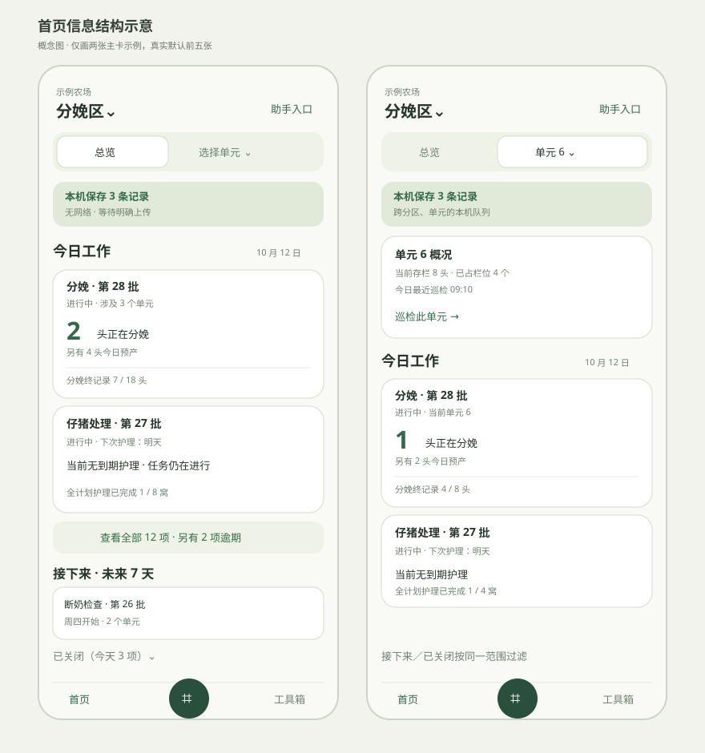
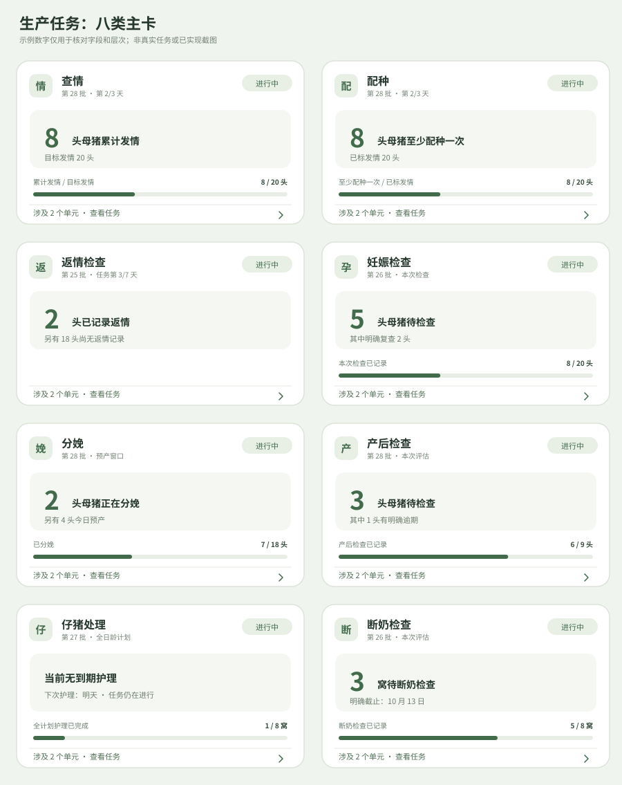
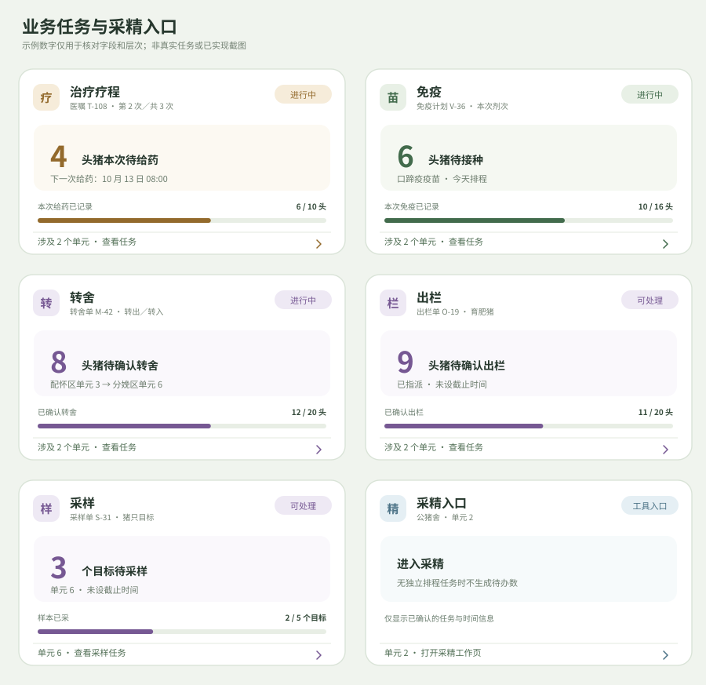

# 首页工作台 PRD

> 业务数据与任务卡字段的历史梳理稿。当前已确认的展示结构在 Sentri-UI `codex/workbench-home-split@3b2d137` 的 Workbench PRD：当前范围至多 4 个任务实例时逐项显示，达到 5 个时在同一容器内按生产、免疫、转舍等任务大类独立展开；Overview 用精简条目，Unit 用完整卡片。该分支尚未并入 Sentri-UI main，main 的旧两列 tile／不折叠规则不是本轮 Android 的验收基线。本文第 2、3.2、4 节混有更早的排版和业务指标草案；以设计分支的交互规则和本文件中可核实的数据边界分别核对。下方示意图仅用于追查历史指标来源。当前原生连接页只接入可可靠归属的生产、免疫和转舍任务；待做数、农场日期和未来七天等缺口见[后端调整清单](backend-adjustments.md)。

## 1. 目标、使用者和边界

一线员工打开首页，先知道自己所在分区有哪些**正在进行、计划已到或明确分配可处理的任务**，再决定按任务跨单元工作，或固定在一个单元逐项处理。主管使用同一入口查看任务；任务结束操作属于任务详情，不由首页卡片直接提交。离线时，员工必须看清哪些记录只留在本机。

首页拥有：农场与分区入口、精简的分区总览、单元选择和单元概况、任务列表、仅单元范围可见的未来七天日期条、本机待上传入口、今日已结束任务收据、工具箱与记录导航。任务详情、巡检记录、环境设备、扫码、Assistant、实际上传执行各归其所属功能；首页只携带任务 ID、分区、单元和返回位置。业务卡片不得把未接入功能伪装成已经执行。

本版不建立“Ready to complete／待复核完成”状态，不因记录数、进度条达到 100% 或某个单元做完而改变任务状态。任务只有权威来源报告完成或提前结束后才显示已结束收据。前端仍可展示记录进度，但它只回答“已记录多少”，不判断是否可关闭。暂停／中断任务不是本版产品状态。

## 2. 首页结构和导航

| 区域 | 展示与数据 | 操作 |
| --- | --- | --- |
| 顶部 | 当前农场名称、当前分区、Assistant 入口；农场与分区从已选厂区和有权限的位置目录读取。 | 点分区进入选择页；维持现有 260 ms 水平滑动与淡入淡出，减少动态效果系统设置下无动画。Assistant 无角标。 |
| 分区选择 | 每行分区名、单元数、当前存栏、主列表任务实例数；无可靠存栏时显示“存栏待更新”，无可靠任务快照时显示“任务待加载”。 | 记住当前用户在当前农场最后选择的分区。切换分区重置单元为总览，不改任务归属。 |
| 范围切换 | 总览与“选择单元／单元名”并列；单元选择列出所有可访问单元，包括零任务单元。单元行展示主列表任务数、当前存栏、最近巡检。 | 选单元后只改变当前查看范围；底部返回回到首页，不触发任务操作。最多约 15 个单元，当前不设置搜索。 |
| 本机记录 | 有待上传记录时，范围切换下方展示记录数、在线状态和上传状态；没有待上传时在内容底部显示安静的“本机记录已上传”。 | 打开数据同步抽屉。上传由用户明确触发；失败保留记录。队列是本机、当前账户与农场范围，不随分区／单元切换。 |
| 单元概况 | 仅单元范围出现。当前存栏、已占用栏位、最近巡检日期与时间、健康／饲喂关注摘要及可用环境入口。存栏并入概况，不再有第二张重复卡。 | 巡检、存栏、环境分别进入所属功能；有可信未解决维修问题时显示独立入口，不让维修提示落到巡检操作上。无传感器与设备时隐藏环境入口；无概况数据时显示“暂不可用”，不可写 0。 |
| 未来七天 | 仅单元范围出现。明天起连续七个农场自然日，一次全部显示；无跨周、跨月或更早日期浏览。每个日期至少 48×48dp；极窄屏可排两行。 | 点日期只预览当天新开始、尚未启动的任务，今日进行中的任务不移动。摘要保持紧凑；多任务可进入只读明细。总览不显示日期选择。 |
| 主任务列表 | 标题“今日工作”及未完成／今日已结束数量；单元范围可补充农场本地日期。最多四个可见任务实例时全部平铺；从五个起在同一外框内按任务大类折叠。总览始终用任务名称／批次和一条最重要的工作事实，不展示完整进度与时间详情；单元范围使用完整任务卡。 | 类别可同时展开多组；总览展开后是缩进的精简任务行，单元展开后仍是完整任务卡。类别标题与子项通过底色和缩进区分。总览进入整项任务概况，单元进入该单元工作页；从任务返回时恢复分区、单元、滚动位置和展开组。 |
| 今日已结束 | 今天完成或提前结束的任务收据，排在所属类别的未完成卡片之后；少任务时排在完整卡片后。更早记录从“记录”查。 | 浅灰、文字清晰，带完成标记、绝对时间与“查看记录”；整行可点，不展示过时待办数。无独立“已关闭”区域。 |
| 底栏 | 首页、凸出的扫码入口、工具箱；工具箱含记录入口。 | 所属功能未接通时显示明确的“界面预览，功能未接入”，不执行假动作。 |

分区总览**一任务实例一条入口**，不再嵌套单元标题。一个任务跨多个单元时，只出一条当前分区的去重汇总，不展示“涉及 N 个单元”页脚；选单元后沿用同一任务 ID，只缩小业务数字并使用完整卡片。涉及两个分区的转舍任务可在两边找到，任务身份仍唯一，方向在详情里写明。人员或物料等无分区目标的全场采样进入全场任务入口，不复制到每个分区。

## 3. 任务进入首页的规则

### 3.1 身份、状态和时间

任务实例键为 `farmId + sourceType + taskId`；生产任务还带批次，以及确有独立标识时的检查次序或阶段标识，但不能仅以任务名称合并不同批次。查情首页卡不使用轮次标识。按权威任务状态放栏：

| 条件 | 位置 | 卡片状态文案 |
| --- | --- | --- |
| 进行中 | 主列表，任何下一次计划时间都不改变位置 | “进行中”；有下一次动作则附其时间，未知时写“暂无下次计划时间”。 |
| 未开始，计划开始时间在今天或更早 | 主列表 | 今天写“今日开始”；此前已到则写“计划已开始 · 尚未启动”。 |
| 未开始，未来 7 天进入执行期 | 对应日期的预告 | “周二开始／10 月 16 日开始”，不渲染完整进度卡。 |
| 未开始，没有明确时间，但已分配且对应流程允许现在执行 | 主列表 | “可处理 · 未设截止时间”。只有草稿、待排程或常驻工具入口不入榜。 |
| 权威状态为已完成／已提前结束 | 所属类别末尾的收据 | 结束类型及农场本地时间；仅今天在首页展示。 |

以农场时区计算今天、未来七天和跨天窗口。只有日期的计划按农场自然日；带时刻的计划按时刻。`Day N of N` 只有在起止日都明确且有效时显示，N 是含今天的日序号，不是进度。只有明确截止日／截止时刻已过且未完成才标“逾期”；计划开始时间已过本身不构成逾期。没有时间不补今天、不补倒计时。

暂停／中断不设计成产品状态。后端若返回当前未映射的状态，使用只读“状态待确认”，不生成待办数字、逾期或结束操作，记录无凭证诊断事件；不能把未知状态当成已完成。旧接口可能保留取消、跳过等枚举，但本版不提供这些操作。

### 3.2 排序、折叠和数量

先按分区／单元筛选，再按以下优先级稳定排序未完成任务实例：①已确认且需要工人处理的现场异常；②明确截止且逾期；③今日计划开始或今日有明确动作；④计划开始日在今天之前、但未启动；⑤无截止时间但已分配可处理；⑥其余进行中，按已知下一次时间由近到远，未知时间在后。同级按明确动作时间、计划开始时间、稳定任务 ID 排序；刷新不能无故跳动。异常必须有可信记录和可操作去向，不能把 Assistant 的发现直接搬成任务异常。

未完成与今天已结束的可见任务实例合计不超过四张时，全部平铺：总览展示精简任务入口，单元展示完整卡片。达到五张时按**任务大类**归组：生产任务为一类，孕检／查返情等仍各是一项任务；治疗、免疫、转舍、出栏、采样分别为类。整个列表只用一个外框，类别标题展示总任务数和必要的未完成、已结束、明确逾期／异常数量；全部未完成时不重复写“全部未完成”，不得以省略号隐藏重要状态。总览展开后的类别标题用浅底色，子任务为白底缩进的简洁行；单元展开后是完整任务卡。类别按其最高优先级未完成任务排序，无未完成任务的类别在后；类别内仍按上述规则排序，今天已结束的收据按实际结束时间从新到旧排在末尾。默认展开有逾期或异常的类别；没有紧急类别时展开首类。用户可同时展开多类，不采用只能打开一类的手风琴限制。切换范围或从其他顶层区域返回首页后恢复默认；从任务详情返回则恢复原展开组和滚动位置。列表项数是去重的任务实例数，不是类别数，也不把等待中误写成“待办动物数”。

日期条仅在单元范围出现，固定为明天起的七天，按农场时区算自然日，七个日期始终可见；不提供周、月或自定义日期范围切换。点某天只看当天尚未开始的任务实例，按计划开始时间与稳定任务 ID 排序；没有任务写明“当天无新开始任务”，不把进行中的任务移出今日列表。未来任务过多时使用只读明细，不用长列表挤走今日工作。已结束收据只限今天，更早的结果进入“记录”。

分页可用于取数，但排序、总数和类别摘要必须基于完整范围；不能因为只加载第一页就声称“只有 5 项”。加载中、真正空列表、离线旧快照、无权限和读取失败分别显示。主列表为空但未来有计划时显示中性“当前没有进行中的任务”；单元范围保留七天日期条，总览不显示日期条；不用绿色完成标记。离线快照显示最后更新时间。

### 3.3 本机记录和一致性

本机队列按用户可辨识的一条业务记录计数，不暴露底层多个命令。队列包含任务、对象、位置、保存时间、待上传／上传中／失败等状态。成功得到服务端确认才从队列移除。首页任务的权威状态仍由服务端任务或经过验证的缓存提供；本机待上传记录可在相关卡片附“含本机未上传 N 条”，避免重复录入，但不能使任务变成已完成或让全队可见。若离线记录无法安全合并进进度，宁可显示上次服务端数字及独立的本机提示，不做猜测性加法。失败、冲突和结果不明确的记录由数据同步功能解释；首页保留入口和准确数量。

## 4. 通用任务卡契约

总览入口只留两层：①任务名与必要的批次／计划身份；②一个可靠的待做事实，如“5 头待妊娠检查”。无可靠待做数的观察任务只写“进行中”或明确的下一次时间，不把查情累计发情数、配种覆盖数、返情历史数伪装成“待处理 N 头”。有明确逾期可附简短提示；不显示进度条、日序、范围页脚。单元完整卡最多四层：①类型图标、任务名、批次／计划／实际存在的检查次序、简短时间；②一个主数字加业务名词，或一句没有可靠数字的状态文案；③至多一行会改变优先判断的辅助事实；④有可靠分母时才给出**具名**进度及范围去向。行动型卡片的主数字不是简单的“总数－已做”，而是当前范围内可处理的去重对象。单元主数字为 0 且任务仍进行中时，显示下一次计划或“进行中 · 暂无下次计划时间”，不把整项任务标成完成。下文表格中的“总览指标”是任务业务口径，不要求完整展示在首页总览。

进度条只记录一种明确定义的业务进度；没有可信分母、不适合用完成率表达的观察任务不显示条。100% 也只说明进度条所命名的记录已达到分母，**不改变任务状态、不出现“待复核完成”按钮**。卡片不显示疾病治疗建议、推荐剂量或任务详情中的结果率。若同一动物在当前动作中有多条记录，按稳定动物 ID 去重；仔猪护理按窝／栏位稳定 ID 去重，不能把每个护理项目累加成多窝。

下面的图片是早期排版示意；当前生产任务展示以[生产任务首页卡片总览](home-production-task-cards.md)为准。图片中的数字不是真实数据，图标和颜色不作像素验收。旧版首页信息来源与调整理由见[任务卡示例与旧版信息对照](home-card-comparison.md)。

其他任务类型可能因业务事实不同而更换主信息。**生产任务卡统一从[生产任务首页卡片总览](home-production-task-cards.md)查看**：当前卡片、必要分支图及接口缺口都在一页。早期的宽范围示意见[多场景展示方案](home-card-variants.md)；若与后续聚焦稿冲突，以总览中链接的聚焦稿为准。

### 4.1 生产任务卡

下表的“主信息”只决定卡片显示，**不决定整项任务是否结束**。配置中的日数、窗口、次数均来自实际农场任务，不从原型样例固定取值。

| 卡片与身份 | 主信息与辅助信息 | 具名进度、时间和范围 | 点击去向与边界 |
| --- | --- | --- | --- |
| **查情**：任务 ID、批次 | 总览显示旧版的“累计发情 / 目标发情”；目标口径为批次配种上限和非禁用任务猪只数的较小值。目标缺失时只显示已发情数；达到目标时保留真实数字，不改变任务状态。单元有迹象时显示尚未确认发情数及其迹象子集。 | 结果条只表达发情结果，不是查情完成率；无可靠分母就隐藏横条。任务日数沿用可靠计划起点与时长。首页不使用遗留轮次文案或推算逐轮待查数。 | 总览整卡进任务概况，单元整卡进该单元查情；无有效猪只不出卡。旧版满格时的快捷结束入口不放入首页，结束影响与确认留在任务详情。详见[查情分支图](home-heat-card-revision.md)。 |
| **配种**：任务 ID、批次 | 总览沿用旧版“已配种（至少 1 次）/ 已标发情”：分子、分母均限于当前范围内未禁用、已标发情的任务母猪，按猪只 ID 去重。单元卡按已有记录次数和间隔显示可配种人数，以及必要的第几次、未到间隔数；无人可配时显示最近可靠的下次时间，或“暂无已标发情母猪”。 | 总览横条只表示至少配种一次的覆盖比例，**不是配置次数完成率**。单元卡不用这条横条；任务日序只在计划可靠时显示。旧版首配时间算法与配种名单不一致，真实“可配 N 头”上线前须统一规则。 | 总览进任务概况、单元进该单元配种名单。满条不触发首页结束入口；当前 Sentri-UI 手机配种结束流程仍未确认。详见[配种分支图和证据](home-breeding-card-revision.md)。 |
| **返情检查**：任务 ID、批次；有独立监测实例时保留实例身份 | 暂沿旧版：总览显示已记录返情，以及同一历史范围内尚无返情记录的母猪数；单元显示已到预计返情日与已提交迹象。预计日与迹象可能重叠，不能相加，也不能解释为“本次待检查”。 | 任务第 N/M 天仅是配置窗口的时间标签，不是完成率；首页不画返情结果率或观察进度条。当前后端日统计快照不可靠，正式卡默认不画饼点。已返情历史数需包含转出／禁用的历史对象。 | 总览整卡进任务概况、单元整卡进该单元名单；没有返情标记不等于观察完成，首页无快捷结束。暂选卡片与口径见[返情卡](home-return-heat-card-revision.md)；新版观察待处理方案见[feature 校验](home-return-heat-feature-alignment.md)，待 feature 定稿后再决定。 |
| **妊娠检查**：任务 ID、批次、首次／二次／明确安排的复查 | 主信息为窗口已开且本次未记录的去重母猪数，明确复查包含在主数内；辅助优先显示逾期，其次“其中复查 N”，再其次下一次检查时间。 | 进度写“本次检查已记录 X／Y 头”；仅本次检查范围，不把不同轮次合并进一个分母。不确定结果的检查记录算本次已记录，但后续复查仍独立安排。 | 进本次任务概况或单元名单，保留检查轮次。 |
| **分娩**：任务 ID、批次 | Home 顺序为“已记录正在分娩 N 头”“预产日已过且尚未分娩 N 头”“今日预产且尚未分娩 N 头”，之后是下一次预产。辅助至多一条次高优先事实。无可靠预产日时写“预产时间待核对”。 | 进度写“已分娩 X／Y 头”；Y 只含当前仍在任务中的应分娩母猪。死亡、流产直接退出批次和任务，不计入分子或分母。预计日期按每头母猪计算。 | 总览和单元整卡都进分娩房名单；已开始分娩的真实记录优先于预产预测。Sentri-UI 当前死亡／流产行设计需与本轮决定对齐。详见[分娩分支](home-remaining-production-cards.md#分娩)。 |
| **产后检查**：任务 ID、批次 | 主信息为从每头母猪实际分娩时间推导、已到配置窗口且未记录的去重母猪数；辅助优先逾期，只有明确安排的复查才列复查数。 | 进度写“产后检查已记录 X／Y 头”，Y 是当前已分娩且纳入本次检查的母猪，可能随新分娩增加。未分娩母猪不提前进入分母。 | 进任务概况或单元检查名单；异常答案不自行生成复查时间。 |
| **仔猪处理**：任务 ID、批次、日龄护理语境 | 主信息为当前至少有一个必做护理项已到期、尚未记录的去重窝数；辅助显示其中逾期窝数，或下一次护理日期。每窝即使有多个护理项也只计一次。 | 进度写“全计划必做护理已完成 X／Y 窝”；做完今天的项目不等于做完整个日龄计划。日龄与任务窗口分开显示。 | 进任务概况或该单元窝／栏列表；可选项目过期规则未配置时不能自动跳过。 |
| **断奶检查**：旧 `LACTATION` 任务 ID、批次 | 旧版页面名称就是断奶检查；新版主信息为到检查窗口、尚未有本次记录的去重窝／栏数，辅助为明确逾期子集或下一次检查日。旧母猪级记录不能直接当作新版窝级记录。 | 新版目标进度写“断奶检查已记录 X／Y 窝”；检查完成不代表实体转舍已完成。迁移映射未建立前只按旧任务身份显示可核实事实，不另造第二张卡。 | 进任务概况或单元窝列表；检查与实际转舍分别负责。详见[断奶分支与接口缺口](home-remaining-production-cards.md#断奶检查)。 |
| **结束保育检查**：旧 `NURSERY` 任务 ID、批次 | 旧任务页按栏检查；当前任务栏位有 8 栏、5 栏已记录时，示例主信息为“3 栏待结束保育检查”。单元范围只筛选本单元任务栏位。 | “已检查 X／Y 栏”，X、Y 都来自同一份任务栏位快照；进度满格不自动结束任务。无法核定栏位集合时只显示任务入口。 | 进旧任务页的栏位名单；Android 接入前需核对稳定栏位集合与 `check_at`。详见[保育分支](home-remaining-production-cards.md#结束保育与结束育肥)。 |
| **结束育肥检查**：旧 `FATTENING` 任务 ID、批次 | 暂留空：后端有按栏检查命令，但旧 Web 没有对应任务页或首页卡。 | 暂留空。 | 待业务流程和新版设计明确后再设计。 |

### 4.2 非生产任务卡

治疗、免疫和转舍按 Sentri-UI 的共享卡片方向纳入，但对应任务生命周期仍须以后端实际契约为准；旧版其他首页任务按同一信息层次补齐。只把**明确创建、指派或排程的业务任务**作为卡片。以下数量均按当前分区或单元重新计算，缺少可靠字段时改显示状态文案。

| 卡片与实例 | 主信息和第二行 | 进度／时间 | 点击去向与限制 |
| --- | --- | --- | --- |
| **治疗疗程**：疗程／医嘱 ID、对象群、当前给药轮次 | 当前计划给药轮次中到时间、尚无给药记录的去重猪只数；第二行写“第 X 次／共 Y 次”或已配置的下一次给药时间。若医嘱中断状态仍在旧数据中出现，使用只读状态待确认，不推断可继续给药。 | 仅在有本次目标时写“本次给药已记录 X／Y 头”；不把一个给药轮次 100% 当作整个疗程完成。用医嘱的 `scheduled_at`，不自行建议补针、药品和剂量。 | 进医嘱／疗程详情或单元执行名单。治疗记录与临时巡检治疗动作不自动合并成一项常驻任务。 |
| **免疫**：免疫任务 ID、疫苗名称、计划剂次／对象群 | 本次排程中到时间且尚未接种的去重猪只数；第二行可写明确逾期子集或下一接种时间。疫苗名取任务配置，剂量与单位若展示必须成对且来自计划。 | “本次免疫已记录 X／Y 头”；加强针按自己的排程实例计算。使用 `scheduled_at`，不以旧版“已下发 N 天”代替到期日。 | 总览进本次计划概况，单元进接种名单；已删除任务不显示为进行中。 |
| **转舍**：转舍单 ID、来源 → 目标、转出／转入语境 | 当前计划窗口内待确认移动的去重猪只或明确分组头数；第二行写路线和该单元的“转出／转入”。未指定接收单元时写“接收位置待确定”，不猜测容量问题。 | “已确认转舍 X／Y 头”；仅选择对象或目的地不计完成。用计划转舍时间；多单元、跨分区仍是一张任务实例卡。 | 总览进整单，单元进入对应方向的执行页；单位方向可在详情中切换，不在首页拆两张卡。 |
| **出栏**：出栏单 ID、目的／对象群、涉及单元 | 本单仍待确认出栏的去重猪只或分组头数；第二行写对象群或下一已知执行时间。没有计划时间字段时标“可处理 · 未设截止时间”，前提是此单已指派且可执行。 | “已确认出栏 X／Y 头”；目标数须与具体单据的选定对象一致。旧查询未提供计划执行时间，不借创建时间推导逾期。 | 总览进出栏单概况，单元进该单元执行范围；实体离开后的原地点用于历史收据，不回流为当前待办。 |
| **采样**：单个采样任务 ID、目标类型（猪／环境／人员／物料） | 当前任务已明确安排且未采的去重目标数；第二行显示目标范围或明确采样期限。不能把多个采样任务合成一个分母。 | “样本已采 X／Y 个目标”；检测结果是后续状态，不等于已采。旧查询只有创建、采样、检测时间，不能把近 7 天创建视作今天应采。 | 猪／环境目标按明确地点入相应分区；没有地点归属的人员／物料目标进入全场任务入口，不复制到所有分区。 |

**采精**在旧首页按公猪存栏数据分单元生成，并非独立的后端排程任务。本版不因单元里有公猪就生成“今日采精任务”；有独立采精任务 ID 和计划时，才可按共享任务卡契约接入。日常采精入口放在适用单元的工具箱／工作入口，显示“进入采精”而不是虚假的待办数。常规称重、饲喂调整、健康观察归巡检，维修归单元概况，清扫不从原型虚构为任务卡。

## 5. 交互、权限与异常

- 点击主卡仅导航，不能直接结束、重放或上传任务。总览携带任务 ID 与当前分区，单元携带同一 ID 与单元 ID；返回恢复原范围。整任务详情不存在时显示明确未接入说明；卡片仍可只读，但不能通向假操作。
- 提前结束保留 Sentri-UI 的入口、后果说明与确认弹层。当前后端不支持真实提交：最终“长按结束”禁用，并写“暂不可提交”；本机不模拟任务关闭。后端以后提供能力时，先核实权限、未上传记录和该任务的后果，再启用，成功响应后更新权威状态。
- 显示哪些卡片由已选农场、可访问位置和任务权限交集决定。无权限的动作不展示可执行按钮；没有跨用户共享本机离线队列。全场任务需明确的权限与入口，不凭目标字符串推断分区。
- 加载时用骨架或占位；零任务、零可处理对象、资料缺失、接口错误和离线旧快照有不同文案。空数字只在已确认真实为 0 时出现。缓存时间以农场时区显示；网络恢复时刷新，但不抹掉本机待上传记录。
- 切换分区或单元时取消旧请求的页面投影；迟到结果不能覆盖新范围。任务数量、单元人口和记录状态分别可失败，其他区域仍可用。刷新或进程重建后恢复用户／农场／分区选择，不恢复过期任务写操作。
- 文案走 Android 中英文资源；数字、时间和单位本地化；卡片、展开按钮与 Sheet 均有可读辅助技术标签和至少 48 dp 触控区。尊重系统减少动态效果设置。

## 6. 数据契约与实施顺序

| 数据能力 | 产品要求 | 当前工程事实与实施门槛 |
| --- | --- | --- |
| 农场、位置、猪只 | 农场时区、可访问分区／单元、存栏和已占栏位来自权威位置／猪只读取。 | Android 已有农场和猪只读取基础；农场时区、栏位口径仍需验证实际字段。不得用原型常量。 |
| 生产任务目录 | 分页取得完整范围的任务 ID、类型、状态、批次、计划与实际时间；类型详情提供动作数和具名进度。 | `TaskCatalogReads` 与生产详情缓存已建立；首页仍读 `HomePreviewData`。必须新增首页投影，并校验分页总数。 |
| 非生产任务 | 治疗、免疫、转舍、出栏、采样需各自稳定 ID、状态、目标地点、计划／记录字段与详情路由。 | 旧 Web 有业务查询，但不是 Android 已接入证明。每类接入前核对 GraphQL operation、缓存和权限。缺字段时用安全降级卡，不伪造主数字。 |
| 巡检／关注／设备 | 最近巡检按当前单元和农场自然日过滤；关注与维修只显示可信未解决项；设备读数有时间。 | Sentri-UI 原型是独立样例，不能把其数字当真实数据。旧 Web 的巡检缓存存在跨日期统计风险，原生需单独定义查询。 |
| 离线队列 | 本机可见记录数、连接状态、显式上传、成功确认、失败保留。 | 当前 Android 有持久命令队列，但还没有完整的业务写入传输与首页汇总。接入前保留预览标记。 |

建议实施顺序：①真实分区／单元与无数据状态；②生产任务目录、状态和一任务一卡，先不显示未验证的动作数；③逐类接任务详情、业务计数与单元范围；④非生产任务；⑤本机队列投影、巡检及设备入口；⑥真实上传与提前结束能力。每一步均保持未接入入口的明确文案。本文规范目标行为，不以分步实施降低最终验收要求。

## 7. 验收场景

1. 同一批次的两轮检查有两个稳定任务 ID，不合并分母；同一任务跨三单元在总览只出一张卡，进单元后数字缩小且日序不变。
2. 昨天计划开始但未启动的任务仍在主列表，写“计划已开始”，有无截止时间分别验证不误标逾期。
3. 一个进行中任务下一动作在九天后，仍在今日工作且不出未来七天日期条；未来六天尚未开始的另一任务只出现在对应日期的预告，且该预告仅在单元范围可见。
4. 一项无计划时间的已指派出栏单可执行时出现；未指派草稿不出现；采精常驻入口不冒充任务。
5. 任务记录进度达到 100%，权威状态仍进行中：卡片仍在今日工作，不出现“待复核完成”；权威完成后只在所属类别末尾出现可点的收据。
6. 四项及以下全部平铺、五项及以上分类折叠，多类可同时展开。总览平铺和展开后均为精简任务入口，单元保留完整卡；类别标题与子项有明显底色及缩进层级。收起类别仍展示总数、逾期和异常数；同类多任务不合并身份。并列项刷新后顺序稳定。
7. 切换单元后治疗、免疫等只统计该单元目标；跨分区转舍在相关分区可找且方向正确；无地点采样不复制到所有分区。
8. 妊娠复查纳入当前到期数但不重复计猪；仔猪多护理项目只计一窝；查情／返情不把结果率当完成率；分娩正在进行记录优先于预产推断。
9. 本机保存一条业务记录但底层有多个命令时显示一条待上传；失败与无网保留；服务端确认前任务状态不变。
10. 今天没有任务与任务读取失败显示不同；单元未巡检与巡检数据未知显示不同；旧缓存标时间。
11. 提前结束可查看确认说明，但后端未支持时最终提交不可用且任务不变。扫码、Assistant、任务详情未接通时不声称执行成功。
12. 日期跨午夜、设备处于其他时区、进程重建后仍按农场日期判断并恢复当前分区；总览无日期选择，单元未来七日始终从明天起且不能翻到范围外；系统减少动态效果时分区切换不运动。

## 8. 来源、取舍与设计回写

- 新版信息层次：[Sentri-UI 工作台 PRD](../../Sentri-UI/features/workbench/PRD.md)、[工作台状态](../../Sentri-UI/features/workbench/feature.json)、[任务卡规则](../../Sentri-UI/ux/research/home/HOME-TASK-DISPLAY-RULES.md)、[任务卡组件提案](../../Sentri-UI/ux/research/home/HOME-TASK-CARD-COMPONENT.md)。这些资料仍有 `in-design`、`placeholder` 和草案状态；本 PRD 的决定不自动意味着其余 feature 已批准。
- 旧版链路：[首页](../../Sentri/mobile_webapp/src/pages/home/index.tsx)、[生产任务计算](../../Sentri/mobile_webapp/src/pages/home/components/hooks/useTaskData.ts)、[采精入口](../../Sentri/mobile_webapp/src/pages/home/components/CollectionTaskList.tsx)、[巡检缓存](../../Sentri/mobile_webapp/src/db/task/inspection/cacheHooks.ts)。旧 Web 仅提供业务证据，不作为新 UI 的状态和视觉规范。
- 已确认产品调整：任务状态决定首页归栏；移除由记录推断的 Ready to complete；进行中始终留在今日工作；总览精简任务入口且无巡检／存栏快捷入口和日期选择，单元保留完整卡、工具入口与固定未来七日日期条；少任务全量、五项起按大类独立折叠；今日已结束收据归入所属类别；农场时区与明确截止才逾期；提前结束只展示前端流程，后端未支持时不可提交。
- 本版为补齐旧版任务作出的取舍：无排程的采精作为工具入口；出栏／采样无计划时间时不借创建日推断到期；首页结束收据仅保留今天；全场目标不复制到每个分区；缺少阶段任务细节时只显示可靠字段。若真实契约推翻其中一项，先记录证据，再修订本 PRD 与 Sentri-UI 设计源。
- 需回写 Sentri-UI：去掉 `Ready to complete` 的首页推断、CTA、排序等级和演示状态；在仍保留的任务详情里由权威状态处理实际完成。同步更新 `workbench` 状态、共享任务卡规则与原型，避免 Android PRD 和设计源相互矛盾。
