# 生产任务首页卡片

> 评审总览 · 2026-10-14。这里汇集当前生产任务卡的展示口径和示例。图片中的批次、日期、人数均为排版样例；Android 首页尚未接入这些真实业务卡。各 feature 仍有草稿和未决规则。与早期宽范围示例冲突时，以本文所引的各任务聚焦稿为准。

## 共用规则

- 一个任务实例一张卡。分区总览汇总该分区，选单元后沿用任务 ID，只缩小统计范围。
- 卡面保留任务名、批次和可靠的时间；主信息只放一件最值得处理的事，辅助信息最多一行。同一母猪或同一窝只计一次。
- 进度条写明统计内容和分母；满格不代表任务结束。进行中的任务仍留在“今日工作”，完成或提前结束只看权威任务状态，首页没有快捷结束按钮。
- 没有可靠的对象、窗口或记录时，不显示猜出的待办数、逾期数和百分比。只有明确的期限已过才写“逾期”。
- 总览通常进任务概况，单元进工作名单。**分娩例外：两处都进分娩房名单。**已关闭任务统一用首页收据，不逐类另画一张卡。

## 一眼看全

| 任务 | 首页主信息 | 进度条 |
| --- | --- | --- |
| 查情 | 总览：累计发情／目标发情；单元：已记录的发情迹象。 | 总览的发情**结果**比例，不是查情完成率。 |
| 配种 | 总览：至少配过一次／已标发情；单元：当前可配种母猪。 | 总览的一次配种覆盖率，不是全部次数完成率。 |
| 返情检查 | 暂沿旧版：总览显示已记录返情及尚无返情记录；单元显示预计返情日与已提交迹象。 | 不把返情结果当完成率；日统计无可信快照时不画饼点。 |
| 孕检 | 本次到期待检母猪，含已安排的复查。 | 本次检查已记录／本次应检。 |
| 分娩 | 已记录在产 → 预产日已过 → 今日预产 → 下次预产。 | 已分娩／当前仍在任务中的应分娩母猪。 |
| 产后检查 | 按实际分娩时间计算的到期待检母猪。 | 已记录检查／当前应检母猪。 |
| 仔猪处理 | 至少一项必做护理到期且未记录的窝。 | 整个日龄计划已做完／应做窝。 |
| 断奶检查 | 到检查窗口、尚未记录的窝。 | 已记录检查／应检窝。 |
| 结束保育检查 | 尚未记录检查的栏。 | 已检查／当前任务栏位。 |
| 结束育肥检查 | 暂留空，待旧端流程和新版设计明确。 | 暂留空。 |

**查情与配种总览是沿用已确认旧首页结果口径的例外。** 这两个数字不能改写成“今天待处理”，也不能拿结果条判断任务结束。

## 卡片和必要分支

### 查情

总览保留“累计发情／目标发情”；单元有迹象时显示尚未确认发情数及迹象子集。

下图依次是目标达到、目标缺失、单元有迹象。目标满格不出现结束按钮。[口径与旧版对照](home-heat-card-revision.md)。

### 配种

总览的 8/20 表示 20 头已标发情母猪中，8 头至少有一次配种记录；单元卡才显示本次可配人数及必要的第几次拆分。

下图依次展示满格、无发情记录，以及四种单元状态。首次可配时间的旧首页与旧名单算法不同；规则确认前不接真实“可配 N 头”。[口径与旧版对照](home-breeding-card-revision.md)。

### 返情检查

暂沿旧版任务卡：总览显示已记录返情数与同一历史范围中尚无返情记录数；单元显示已到预计返情日的母猪和已提交迹象。这些数不能相加，也不代表本次待检查数。当前后端日期统计快照口径不稳，正式卡默认使用无日统计样式。新版“本次观察待处理”设计留待返情 feature 定稿后再决定。[旧逻辑与统计核对](home-return-heat-card-revision.md) · [新版候选及冲突](home-return-heat-feature-alignment.md)。

下图依次是总览全部返情、无有效配种时间、单元预计日与迹象、单元仅有迹象、单元等待、单元时间待核对。日统计饼点仅保留在专题稿里作为待修复的数据设计示意。

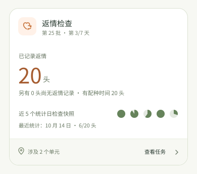

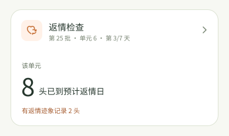
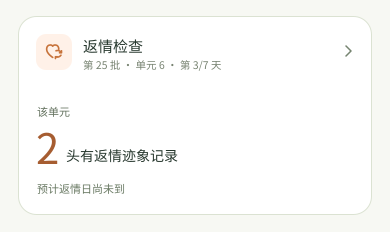

### 孕检

只数**本次**窗口已开且未记录的母猪；到期复查计入主数，但不重复计同一头。检查结果“不明确”不等于最终已孕，后续复查另有安排。

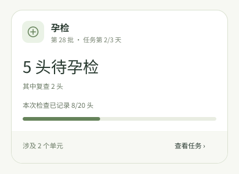

下图依次是过期子集、单元等待、检查信息待核对。

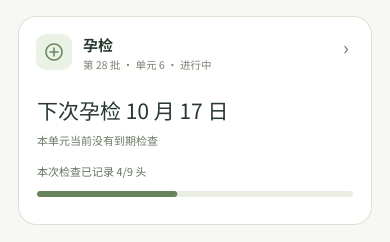

### 分娩

开始分娩以首次记录为准。预产日已过只提示核对，不推断实际分娩状态。进度只数**已分娩**：死亡、流产母猪直接退出批次和任务，不留在首页分娩卡的分子或分母。分母是当前仍在这项任务内、应分娩的母猪。Sentri-UI 分娩 feature 现有死亡／流产留在房间名单的设计与此决定冲突，后续需对齐。

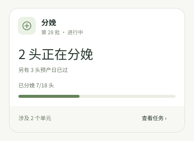

下图依次是预产日已过、今日预产、下次预产、日期待核对。总览和单元整卡均进入分娩房名单。

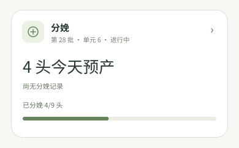
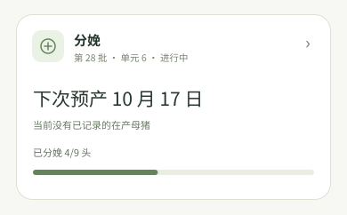

### 产后检查

只纳入实际已分娩的母猪；新分娩会让分母增长。只有**明确安排**的复查才出现在首页，异常答案不自动产生一个复查日期。

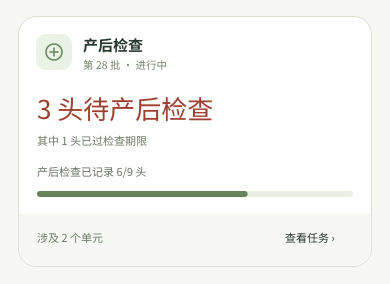

下图依次是已安排复查、下次检查、等待分娩记录。

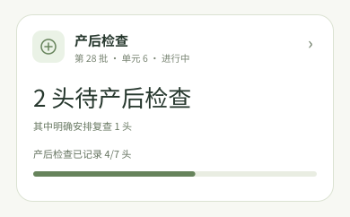

### 仔猪处理

按窝去重：一窝今天有两项护理，主数仍只加一窝。进度看**全部日龄计划**，今天没有到期项目不代表这窝已做完。

下图依次是有项目过窗、下次护理、等待新窝、本单元计划已做完。

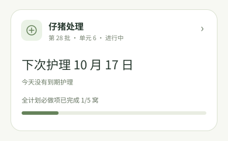

### 断奶检查

新版按窝／栏检查。旧版任务枚举 `LACTATION` 的页面名称就是“断奶检查”，并不存在另一个“旧哺乳检查”任务。新旧对象口径不同，需建立迁移映射；同一任务不能重复出卡。

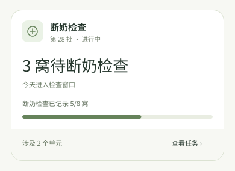

下图依次是有明确过期、下次检查、安排待核对。当前后端没有独立断奶任务和窝级检查契约；这组图是目标设计。

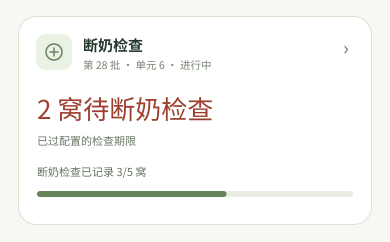
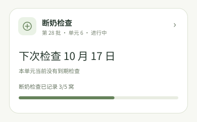

### 结束保育检查

旧版有“结束保育检查”任务页，按栏展示并提交检查结果。首页卡按当前任务栏位去重：有 8 栏、5 栏已记录 `check_at`，就写“3 栏待结束保育检查”和“已检查 5/8 栏”。单元只收窄栏位范围；检查记录齐全不自动结束任务。旧版首页未画这张卡，因此这是依据旧任务页逻辑补出的首页展示。栏位集合变化时，分子、分母必须用同一份任务快照。[旧版依据与接口缺口](home-remaining-production-cards.md#结束保育与结束育肥)。

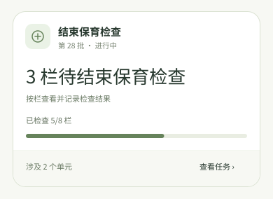

### 结束育肥检查

旧后端有按栏检查命令，但旧 Web 没有对应任务页或首页卡，新版 feature 也只有占位。卡片样式和数据口径暂留空，待业务流程明确后再设计。

## 当前接口还缺什么

| 任务 | 要补齐的事实；补齐前怎么办 |
| --- | --- |
| 配种 | 统一首次可配与后续间隔算法；未定时不报“可配 N 头”。 |
| 返情检查 | 暂沿旧版结果和预计日期。日统计缺可靠历史快照，先不画饼点；新版逐时段观察记录待 feature 定稿后再决定。 |
| 孕检 | 本次检查身份、多次检查记录、复查归属及窗口；单个最新结果不能算“本次待检”。 |
| 分娩 | 死亡／流产退出批次和任务时，同步从进度分母移除；接口需给当前任务对象及已分娩记录，预产日期按个体核算。 |
| 产后检查 | 窗口起止、独立复查排程及记录；没有排程就不报复查或逾期。 |
| 仔猪处理 | 稳定窝身份、完整必做计划、项目窗口终点、免做与跨栏关系；没有这些就不报到期窝数或全计划进度。 |
| 断奶检查 | 新版窝级记录、检查窗口，以及和旧 `LACTATION` 任务的迁移关系；未建立映射前按现有任务身份出卡。 |
| 结束保育检查 | 统一任务栏位快照及 `check_at` 口径，按栏去重；旧任务页已有按栏提交。 |
| 结束育肥检查 | 旧端缺任务页和首页卡，暂不定义展示数据。 |

全量任务目录还需要按分区／单元统一过滤和去重，按农场时区判断“今天”。接口细节、旧版差异及仍需产品确认的规则见[孕检至断奶及旧任务的核对稿](home-remaining-production-cards.md)。

## 依据

[首页 PRD](home-prd.md) · [Sentri-UI Home 展示规则](../../Sentri-UI/ux/research/home/HOME-TASK-DISPLAY-RULES.md) · [任务卡组件规则](../../Sentri-UI/ux/research/home/HOME-TASK-CARD-COMPONENT.md)。查情、配种、返情的专题稿已在各卡下链接；其余生产任务的旧版计算、新版 feature 与 Android GraphQL 对照集中在[核对稿](home-remaining-production-cards.md)。
