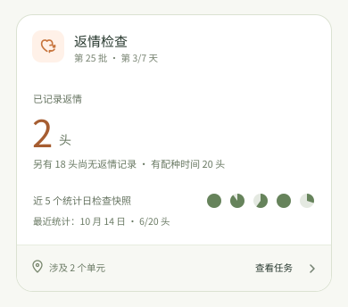

# 返情检查首页卡片：旧数据、新样式

> 本轮暂选的首页口径：沿旧版结果和预计日期，用新版卡片样式。返情 feature 定稿后，再决定是否改用[新版候选卡片](home-return-heat-feature-alignment.md)。批次、日期和头数只用于排版，不是当前农场数据或 Android 已实现页面。

## 总览：返情结果

旧版总览右侧写“返情 / 未返情”，代码实际算的是 `已返情数 / (有配种时间的任务猪只数－已返情数)`。减法后的 18 头里，可能有**返情迹象**，也可能尚未检查，不能统称“未返情”。本稿将其改写为“已记录返情 2 头；另有 18 头尚无返情记录”，并列出原任务纳入、有配种时间的 20 头作为范围。**返情结果必须保留已转出／已禁用的历史对象，不能套当前可观察对象的未禁用筛选。**没有表示“返情完成率”的横条。正式卡默认无日统计饼点。这一暂定口径与 Sentri-UI 当前 Home 规则有冲突，待返情 feature 定稿后一并处理。

| 卡面 | 旧版字段及新卡口径 |
| --- | --- |
| 第 25 批、第 3/7 天 | 批次、`calculateDoingDays(task)`；有可靠计划起点和时长才显示日序。天数不是已检查次数。 |
| 已记录返情 2 头 | 旧版 `re_estrus_pig.is_in_re_estrus`。若用于任务详情，应按任务实例的稳定猪只 ID 统计历史结果，**包括返情后转出或禁用的对象**；不能仅按当前可观察名单计算。 |
| 尚无返情记录 18 头 | 示例以原任务有配种时间的 20 头为同一历史范围，再减去已返情的 2 头；只是“没有返情结果”这一事实，不代表已检查、未返情或仍留在批次的最终判定。该数不适合作为首页待观察人数。 |
| 近 5 个统计日检查快照（候选） | [另图](home-return-heat-card-branches/overview-with-stats.svg)示意 10 月 10–14 日五条日期统计，分别为 20/20、18/20、12/20、20/20、6/20。每个饼点绿色扇区为该条统计的 `checked.length / total_count`，灰色为余量；点位从左到右按农场日期升序。当前数据不可用于正式卡。 |
| 涉及 2 个单元 | 当前分区内有这项任务猪只的单元；整卡进入任务概况。 |

### PieCard／日期统计逻辑核对

旧首页 `ReEstrusTaskProgress` 固定留 7 个位置，只取返回数组末尾 7 条：前面的有效位置以**全量绿点／未全量橙点**二值显示，最后一条才用 `ProgressPieIcon` 显示真实比例，剩余位置画灰点。旧 GraphQL 关系没有 `order_by`，因此“数组末尾”并不保证日期最近；旧卡的灰点也不能区分未来日期和缺统计。本稿改为**至多 7 个实际有值的日期统计，每条都画对应比例的饼点**，避免历史 18/20 与 1/20 都变成同一个橙点。

拟定的前端映射：按农场本地统计日核对并升序排列；同一日重复快照只取时间最新且有效的一条；取末尾最多 7 日。每条的 `checked` 必须是猪只 ID 列表、`total_count` 必须为正数；比例约束在 0–1。0/20 是一枚全灰的**有数据**饼点，缺行或字段无效则**不画点**，不补齐到 7 枚。卡面给出最近一日的实际 `X/Y` 和日期，任务详情可查看各日数值；这些是提案，需与后端口径一同确认。

**当前后端统计不能直接作为可信的首页检查进度。** `ReEstrusTaskDailyStatisticsService` 的 `checked` 只数任务猪只当前保存的 `check_at` 落在该日者；重复检查会覆盖 `check_at`，无法从此字段重建过去每天所有检查。`total_count` 则是生成快照时 `task.pigs` 的长度，未排除禁用猪只。日统计由 `production-daily` 定时流程生成，统计时点可能早于当天检查，且检查命令不会同步刷新这张统计。因此最新一枚饼点既不是实时进度，旧快照也未必能代表完整的一天。正式接入前须明确日统计何时结算、历史检查从何处读取，以及分母是否只含当日应检查对象；在契约未落实时首页使用下方“无可用日统计”卡，不显示误导性的饼点。

### 没有每日检查统计

结果数与配种对象数可读取、但 `re_estrus_statistics` 为空、分母无效或当前后端快照尚未满足上述口径时，只保留结果和范围，不画检查日点位。缺统计不是“今天没有检查”，更不是“检查已完成”。

### 当前范围全部记录返情

20 头都记录返情属于结果事实，绝不是成功进度 100%。任务是否结束仍看权威状态；首页不出现快捷结束按钮。旧首页的“结束任务”样式在返情卡没有点击处理，且只按返情率四舍五入后达到 100% 出现，本身不足以定义结束规则。真正结束时的批次去向和确认留在任务详情。

### 缺可用配种时间

分母为 0 或无法核实时，不显示 `0/0`、`0%`、返情率或估算日期。任务仍有有效猪只时保留简短入口；完全没有有效任务猪只时按旧首页规则不出卡。

## 单元：预计返情日与迹象记录

旧版单元卡显示“已到预计返情期”头数和“有返情迹象”头数。前者按每头母猪的配种时间加该任务配置天数算；后者来自已经提交的迹象记录。这两个数**可能重叠，也可能不重叠**，首页不能把它们相加，也不能据此推算“本轮待观察 N 头”。单元卡不套总览的返情结果数或检查日点位。

### 已到预计日，且有迹象记录

“8 头已到预计返情日”只描述日期，不能证明 8 头今天都没查过。新卡计算时排除已确认返情、禁用或缺有效配种时间的母猪，避免旧版把缺时间默认距离 `-1` 当作“已到期”，也避免已返情的母猪继续占用现场关注数。迹象 2 头是独立的已提交记录，点击整卡进入该单元名单。

### 仅有迹象记录

有迹象可以发生在预计日期前，所以 0 头到预计日、2 头有迹象是一种真实组合。卡片优先展示这 2 头，日期仍按实际计算，不把它们冒充已确认返情。

### 预计日期尚未到

单元母猪均有有效配种时间、没有已到预计日或迹象记录时，显示最近一头的预计日期。旧版也用最小正距离找下次时间；新卡保留该选择，只把动态倒计时收敛成农场本地日期。

### 配种时间缺失

有任务猪只却缺配种时间时，写清需核对，不把它们计为“已到预计返情日”。如果同一单元还有可计算的母猪，优先展示有依据的日期和迹象；缺时间的数量只在它会影响判断时附在详情。

## 不由首页推断的事

- **“尚无返情记录”不等于“未返情已确认”。** 旧版提交结果和新版草稿对无标记母猪如何成为最终阴性结论存在不同设计；首页只显示记录事实。
- **检查日点位不等于日序。** 点位来自实际的日期统计；“第 3/7 天”来自任务计划。若统计日缺失，不按日历天数自动填点。当前后端快照口径待修复，不能把图中的示意比例作为生产验收依据。
- **当前待检查人数尚不能从旧首页字段可靠得出。** 旧单元算法只有预计日期与迹象数，没有“当前这一轮哪些猪已检查”的稳定口径。此前场景稿中“本轮待观察 4 头”“本轮已记录”等图不再用作本卡依据。
- **返情检查次数要认任务实例。** 旧任务 ID 的一段索引用于读取 `after_estrus_days[taskIndex]`，但不能把不同任务实例合并成一张卡，也不能只凭第几次文案推断当前检查轮次。

参考：[旧首页返情计算](../../Sentri/mobile_webapp/src/pages/home/components/hooks/useReproductiveTaskData.ts)、[旧首页返情封装](../../Sentri/mobile_webapp/src/pages/home/components/tasks/ReEstrusTask.tsx)、[旧总览卡与日期统计](../../Sentri/mobile_webapp/src/pages/task/cfq/components/ReEstrusTaskProgress.tsx)、[旧饼点实现](../../Sentri/mobile_webapp/src/components/progressPieIcon/index.tsx)、[旧单元卡](../../Sentri/mobile_webapp/src/pages/task/cfq/components/UnitDetailTaskProgress.tsx)、[旧任务页对象口径](../../Sentri/mobile_webapp/src/pages/task/cfq/assists.tsx)、[后端每日计算](../../Sentri/backend/apps/production_v2/src/production_v2/domain/services/scheduling.py)、[后端生成命令](../../Sentri/backend/apps/production_v2/src/production_v2/service_layer/handlers/commands/production_tasks/estrus_mating.py)、[后端日流程](../../Sentri/backend/apps/orchestration/src/orchestration/flows/production.py)、[新版返情 PRD](../../Sentri-UI/features/return-heat/PRD.md)、[新版返情研究](../../Sentri-UI/ux/research/tasks/return-heat.html)、[首页卡片样式规则](../../Sentri-UI/ux/research/home/HOME-TASK-CARD-COMPONENT.md)。
