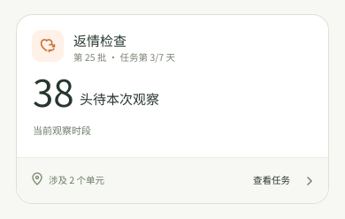
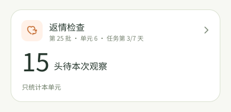
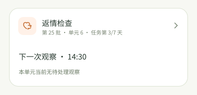
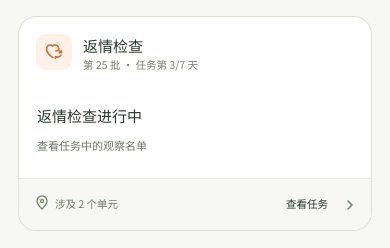

# 查返情 feature 与首页任务卡校验（新版候选）

> 2026-10-14 评审稿；对照 Sentri-UI `de7ab8e7768b3482812740cd622a53530f4cd160` 加上其当前未提交的 `workbench/PRD.md`、Home 卡规则改动。示例图片中的人数和时间均为虚构。本轮首页暂沿[旧版返情卡口径](home-return-heat-card-revision.md)，此稿作为新版候选，待 feature 定稿后再决定是否采用。

## 先分清三个位置

1. **首页任务卡**回答“此刻进入哪个任务”：当前范围内本次观察需要处理多少头；没有这项工作时，提示下一次观察或任务仍在进行。
2. **任务概况**回答“整项任务怎么样”：配置的观察天数、返情数／率、各单元分布、检查活动和结束入口。
3. **单元工作名单**回答“具体看哪头”：配种日推导的个体窗口、迹象、已返情、缺数据、记录和更正动作。

Sentri-UI `return-heat` 的当前 screen 是返情记录入口、记录和结果；旧列表与概况在 `feature.json` 中标成 `earlier`，PRD 本身仍是 Draft。较新的 Home 规则明确首页只放当前观察的可处理数，不放返情结果、返情率或日期进度条。Feature 所说“观察任务以天数衡量进度”应落在任务概况，首页可保留**任务第 N/M 天**作为时间标签；它不是已完成 N 天，也不是某头母猪的观察天数。

## 与旧字段重画卡的逐项对照

| 旧卡内容 | 校验 | 对齐建议 |
| --- | --- | --- |
| “已记录返情 2 头”占主数字 | **首页冲突。** 返情是结果，而且是不利结果；Home 主数字要求当前可处理的观察对象。 | 移到任务概况。首页主数字改为有依据的“本次观察待处理 N 头”。 |
| “18 头尚无返情记录／有配种时间 20 头” | 文案比旧版“未返情”准确，但它是**历史结果范围**，不是当前待观察人数；无返情标记也不证明本次已查。 | 不作为首页辅助句。若任务概况保留，分母必须是同一任务实例的原纳入范围，结果数包括后来转出／禁用的母猪；不能混用当前活跃名单。 |
| 近 N 个统计日饼点 | **首页冲突，且数据不足。** Home 不放检查进度；现有后端日快照也不能证明一天按配置完成两次观察。 | 放到任务概况的“检查活动”研究区。只有服务端定义了按日期／轮次的观察证据和结算时间，才能把饼点解释为检查覆盖；否则不展示。 |
| “第 3/7 天” | **方向一致，需补语义。** Home 的时间标签可以显示任务日序，但不能表示已完成观察；个体返情窗口依各自配种时间计算。 | 标签写“任务第 3/7 天”，时区、起止和长度由任务配置决定。 |
| 单元卡“8 头已到预计返情日” | **口径冲突。** 日期已到只表示该母猪进入观察窗口，不能判断本次是否已观察。 | 单元首页使用该单元“本次观察待处理 N 头”；预计日期分布留在工作名单。 |
| 单元卡“有迹象记录 2 头” | 迹象是已记录观察，feature 说它会留在批次并延续至后续检查；不能仅凭迹象自动升级为新的首页待办。 | 留在名单的提示和任务概况；只有明确的再次核查要求形成可处理异常时才放到首页。 |
| “缺配种时间”分支 | **有价值但位置待定。** Feature 列表保留 `No data`，不把母猪静默排除；Home 规则没有决定它是否占一个异常卡位。 | 名单中保留可核对状态；如业务确认需要当班修复，首页可用异常辅助句提示数量，不能混入正常观察人数。 |
| 整卡进入任务、单元进入单元名单；首页无结束按钮 | **一致。** 结束任务及返情后的批次去向留在任务详情与记录动作。 | 保留。两次返情检查若确为两个任务实例，也分别出卡；次数不能从任务 ID 文案猜测。 |

## 建议卡片示例

### 有可靠的本次观察数据：总览与单元

38 与 15 是**示例数**，不是现有接口可直接得出的值。总览与单元是同一个任务实例；单元只收窄对象范围，不重新计算任务第几天。卡面不放“返情 2 头”、结果率、历史饼点或结束入口。

### 当前没有可处理观察

只有配置提供下一次观察时间时才写“14:30”；否则写“本单元当前无待处理观察”。未标记返情绝不自动产生“本轮已完成”。“本轮完成”需要独立观察活动证据，当前 feature 将该规则留作未决。

### 当前接口的保守卡

在只能读取任务状态和猪只最新检查字段时，首页保持权威的“进行中”任务入口，不编造待观察人数或下一次时间。具体名单仍由任务页呈现；这张保守卡是数据契约落实前的 UI 退路，不是理想的最终业务卡。

## 要让主数字成立，缺什么

“本次观察待处理 N 头”至少需要：任务实例与可选的第几次监测、农场时区、每头母猪的有效配种时间与当前所属单元、任务配置的个人观察窗口、当天观察时段／次数、该时段每头是否有**实际检查活动**、已返情转出与其他禁用的排除规则。去重键是任务实例 × 观察时段 × 猪只；总览和单元必须使用同一批事实。

现有 Android `NativeReEstrusTask` 查询有 `mating_at`、`check_status`、`check_at`、`is_in_re_estrus` 等**最新状态**，没有任务观察排程和逐时段活动记录。后端 `check_at` 会被再次检查覆盖，`NOT_RE_ESTRUS` 与单独的 `submit_re_estrus_status` 仍存在；这与 Sentri-UI 草稿的“两选项、无需负向标记、标记即提交”和“观察轮次只有显式活动才能完成”不是同一契约。不能用 `窗口内且没有返情标记`、`有配种时间减已返情数`、`已到预计返情日`，或旧日统计饼点，推导待观察人数。

## 需产品与后端共同确认

1. “本次观察”的实例与边界：每天两次时如何识别当前轮次；只是配置时间，还是有明确开关和结束记录？
2. 没有返情迹象时怎样留下“确实观察过”的证据。Sentri-UI 草稿不要求逐头负向标记，后端仍有 `NOT_RE_ESTRUS` 与提交操作；两者需统一后才能计算待观察／本轮完成。
3. “已返情”是在标记时还是提交时移出原批次。它影响名单归属和结果历史，不能由首页自行决定。
4. 多次返情监测是否各自为独立任务实例、任务标题是否显示“第几次”；当前 feature 只保留了配置概念，实际第二次的规则未确认。
5. 缺配种时间的母猪是否需要在首页上升为当班异常，以及有迹象记录是否会触发再次核查；未确认前留在任务名单。

参考：[Sentri-UI 查返情 PRD](../../Sentri-UI/features/return-heat/PRD.md)、[feature 元数据](../../Sentri-UI/features/return-heat/feature.json)、[返情设计研究](../../Sentri-UI/ux/research/tasks/return-heat.html)、[工作台 PRD](../../Sentri-UI/features/workbench/PRD.md)、[Home 卡规则](../../Sentri-UI/ux/research/home/HOME-TASK-DISPLAY-RULES.md)、[Home 组件状态](../../Sentri-UI/ux/research/home/HOME-TASK-CARD-COMPONENT.md)、[Android 返情读取](../app/src/main/graphql/ReEstrus.graphql)、[旧字段重画卡](home-return-heat-card-revision.md)、[后端返情任务模型](../../Sentri/backend/apps/production_v2/src/production_v2/domain/models/tasks/re_estrus.py)。
