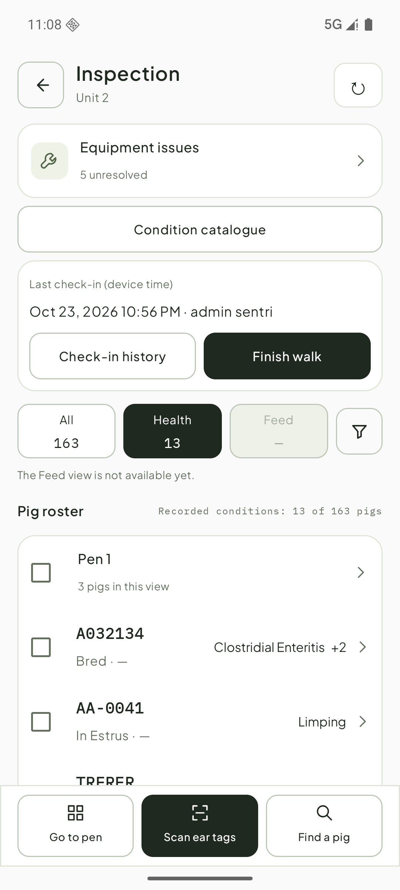

# 巡检动物行：Android 实现反馈

2026-10-26。设计基线：Sentri-UI `main@f66affd` 的 Row · animal、ConditionTag compact 与 `inspection.walk`。

## 问题与改动

原来用通用 `SentriRow` 将阶段和病症拼在第二行，病症多时难以扫读，也没有明确的剩余条目数量。Android 新增 [SentriAnimalRow](../app/src/main/java/com/sentri/nativeapp/design/SentriAnimalRow.kt)：

- 左侧固定 112dp，16sp 半粗等宽身份文字，下面 13sp 阶段／来源；长文字省略。
- 右侧单行病症名称，按可用宽度放入；第一项保留、必要时省略文字，其余折为 `+N`。无障碍信息保留完整病症名称。
- 勾选框是独立的 48dp 点击区域；行正文只打开详情。选中为中性 `well` 底色和深色勾选。
- 已复用到巡检主名单、栏位名单、扫码结果和查找结果；扫码仍保留其他单元／离线来源文字和转入入口。
- Android 动物行新增可选 `arriving` 状态：刚扫到时短暂高亮，再淡回选中／普通底色，避免选中底色盖住扫码提示；其他消费方默认关闭。该变体同样待审核后再回写。

通用 `SentriRow` 不足以表达这一结构，因此在 Android 新增动物行变体；其他通用 Row 消费方未改。尚未回写 Sentri-UI，供用户整体审核。

## 数据边界

现有接口没有逐病症 Care，当前只用中性深色名称，不画 act／watch／ongoing 的护理样式，不从猪只级 triage 推断排序。按现有记录顺序排列，`+N` 是剩余记录条目数。健康资料未返回时显示未知，不能当作没有病症。阶段起点仍未核实，天数保留 `—`。

这次完成的是动物行结构与选择行为，不能据此认为完整的 ConditionTag 护理状态已经接通。查找页也已复用动物行：单元下按栏位列匹配项，保留关键词高亮；辅助标识命中可占第二行。同单元提供独立勾选，其他单元保持先转入。

扫码结果也已改为单元下的栏位卡片，栏头用等宽编码和“已扫 N 头”，不当作存栏数；本单元优先，最近扫码的栏位／猪只在该单元前面，重复不新增。读卡器断开保留可查看的结果，扫码控制底栏仍遵守无读取器时隐藏的规则，返回巡检后继续处理已选。

## 效果与验证

真实 dev 会话下进入 Unit 2 巡检，All 163／Health 13，首条多病症显示名称与 `+2`。仅执行只读查看，没有新增健康记录、打卡或治疗。

语言检查与 APK／测试包构建通过；API 36 定向 4 项通过，覆盖长名称折叠、选择与打开分离、名单选择、扫码选择和病症→治疗预览→返回。真实截图已目测核对。中文／大字体／更窄屏、屏幕阅读器实际朗读、旧系统、完整设备回归未执行，统一见交付待测清单。
