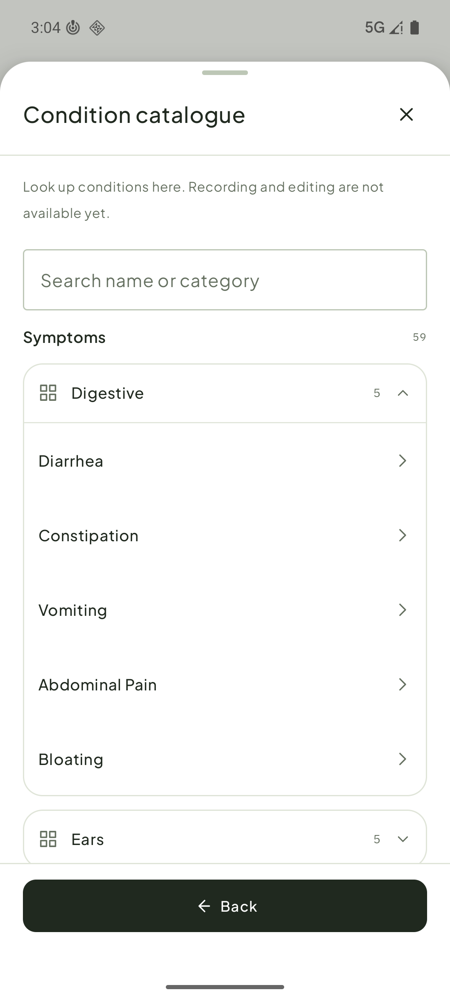
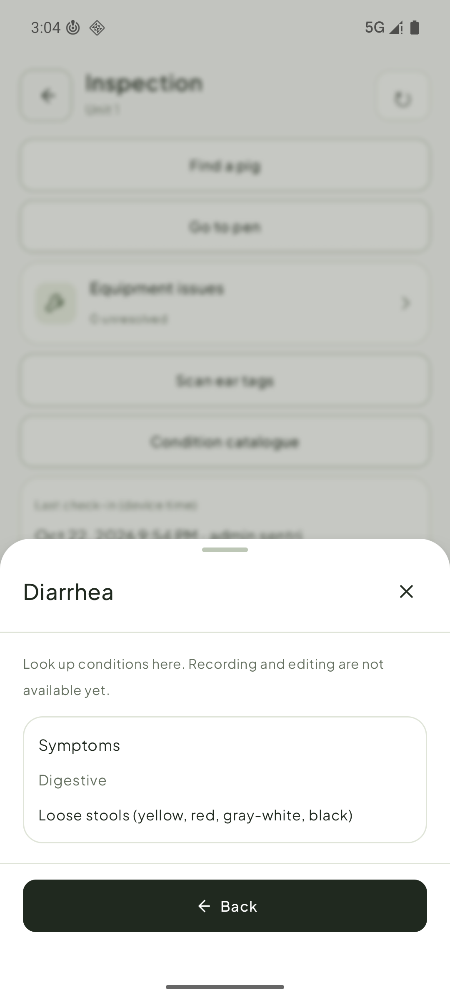

# 巡检病症目录：Android 实现反馈

设计源：Sentri-UI `main@f66affd` 的 `conditions` skeleton、`inspection` 和 `disease` PRD。此处是 Android 当前的只读目录，不代表新版病症选择器或健康记录写入已完成。

## 本地实现

- 搜索或展开旧接口的症状部位、疾病分类后，可点条目查看名称、分类和接口返回的说明。
- 详情底部“返回”和系统返回回到原搜索结果或展开分组；右上角“关闭”退出目录。
- 离线旧快照在列表和详情都标明。页面只读，不能新建、修改或设置 Care。

## 组件反馈，当前决定

此前 Android `SentriSheet` 把底部“返回”和右上角“关闭”共用 `onDismiss`，多级目录无法分别处理。现增加可选 `onClose`：旧调用仍默认走 `onDismiss`；只有目录详情指定 `onClose`，让“返回”回列表而“关闭”退出目录。组件外观未调整。用户已确认先保留 Android 实现，本阶段不回写 Sentri-UI。

API 36 模拟器：`InspectionWalkScreenTest` 全类 25 项通过；`SENTRI_GRADLE_DIRECT=1 ./scripts/verify.sh` 通过。图片来自已登录 dev 模拟器的真实目录；系统返回在该界面使用设备按键事件实测回到展开的 Digestive 分组。Compose 测试宿主的直接按键注入未能命中该 Dialog，不作为通过依据。真机尚未验收。
